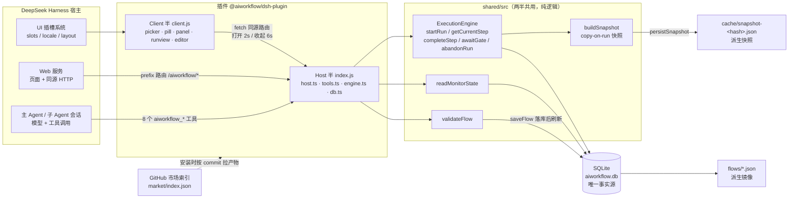
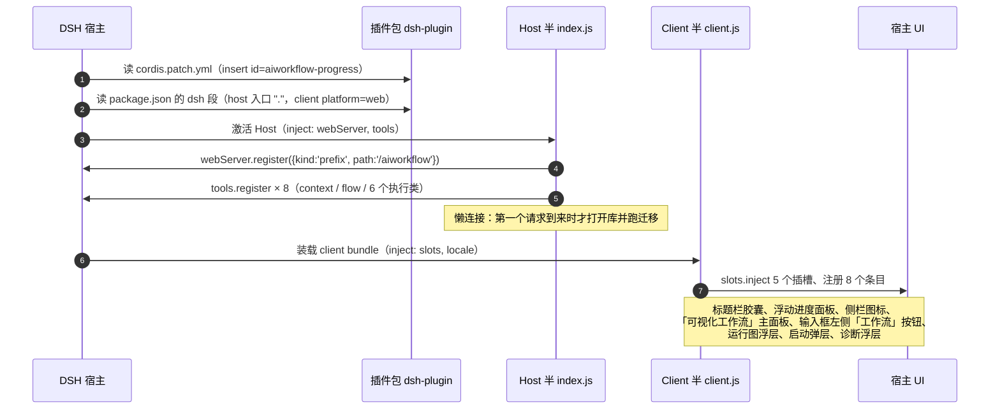
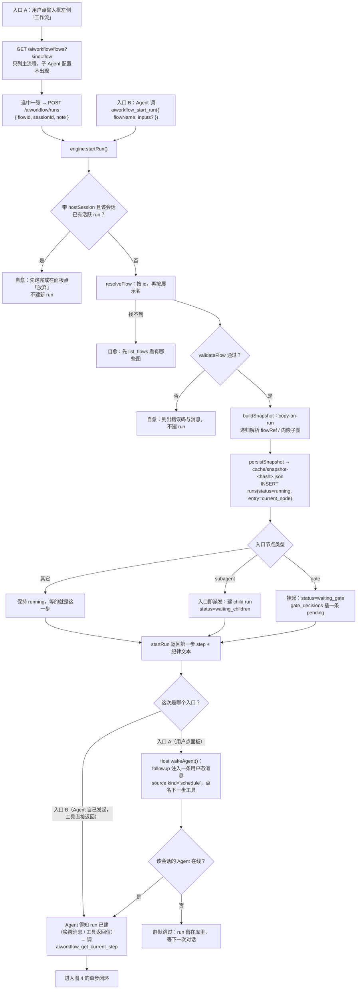
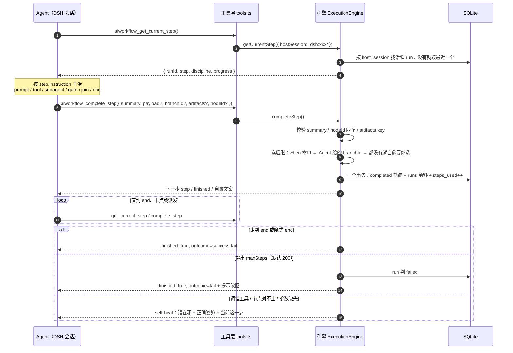
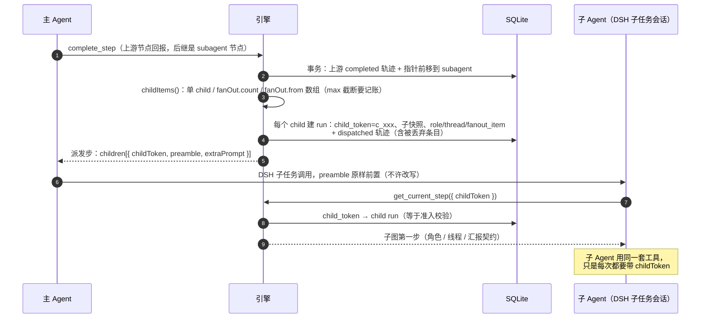
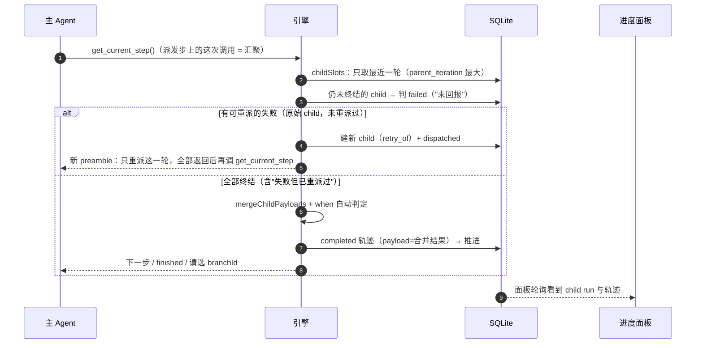
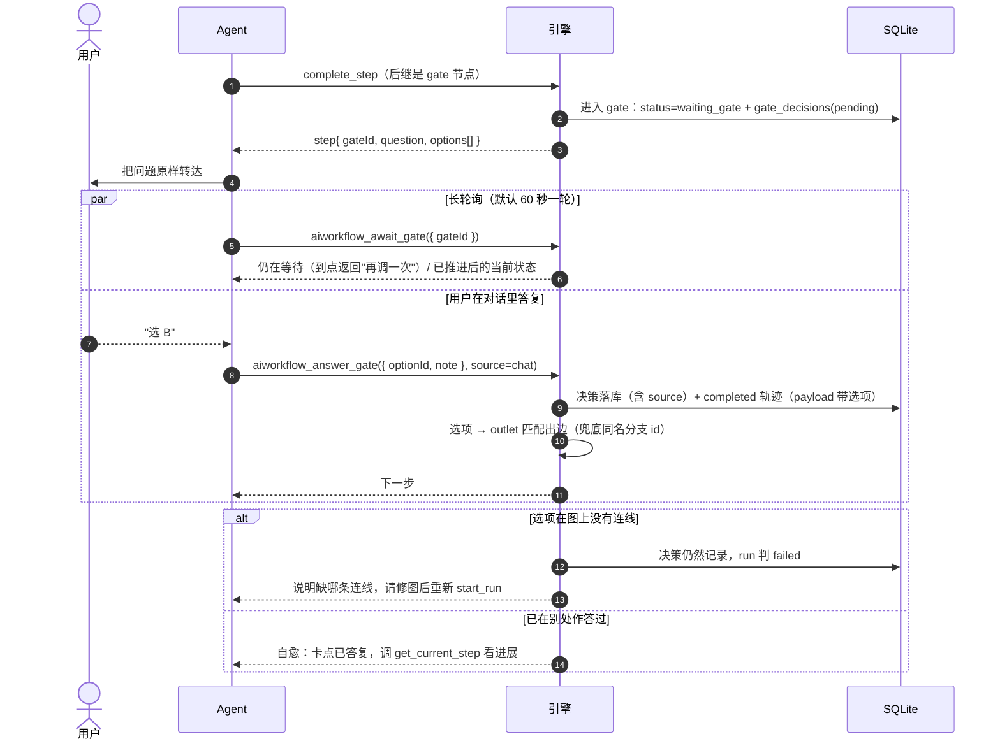

# aiworkflow 架构与关键流程（图示）

> 用图说清四件事：**插件是怎么装起来的**、**一次 run 是怎么启动的**、**Agent 与插件怎么一步步对话**、
> **两条特殊路径（子 Agent 派发 / 人工卡点）怎么走**。
> 图全部是 Mermaid 源码（GitHub、VS Code 直接渲染），每张图后面跟「读图要点」和代码位置。
> 最后修订：2026-10-29（对齐 `main` 上 0.1.2 的实现）。

阅读顺序：图 1 建全局印象 → 图 2 装载 → 图 3 启动 → 图 4 单步闭环 → 图 5.1/5.2 子 Agent → 图 6 卡点。

一句话版：DSH 装载插件时注册**一条 `/aiworkflow` 前缀路由 + 8 个 Agent 工具**；启动 = **建 run（落快照、定入口）**；
之后全靠 Agent **每步「领指令 → 干活 → 回报」**推进，插件只负责记状态、算下一步、把该给的信息给到。

---

## 1. 架构总览



**读图要点**

- 只有两个进程内入口：**HTTP 路由**（Client 半、外部页面）和 **Agent 工具**（模型）。两者调用同一批 `shared/` 函数、同一个 SQLite 连接，没有第二套逻辑（`dsh-plugin/src/host.ts:41`、`dsh-plugin/src/tools.ts:38`）。
- Client 半不碰数据库：它只会 `fetch('/aiworkflow/*')`，所以刷新页面、换浏览器都不影响状态。
- `flows/*.json` 与 `cache/` 是派生品：SQLite 写成功后才刷新镜像，删掉不影响 run（`shared/src/flows.ts:77`、`shared/src/snapshot.ts`）。

| 关注点 | 代码位置 |
|---|---|
| Host 路由注册与分发 | `dsh-plugin/src/host.ts:41` / `:59` |
| Agent 工具注册（8 个） | `dsh-plugin/src/tools.ts:38` |
| 引擎（推进、快照、卡点、派发） | `shared/src/engine.ts`，类 `ExecutionEngine` |
| 校验（存图与启动共用） | `shared/src/validate.ts` |
| 快照（copy-on-run） | `shared/src/snapshot.ts` |

---

## 2. 插件装载（DSH 启动时）



**读图要点**

- Host 半缺 `webServer` / `tools` 任一就不激活；Client 半缺 `slots` / `locale` 同样不激活（`dsh-plugin/src/host.ts:27`、`dsh-plugin/src/client.tsx:14`）。
- 注册全包在 `ctx.effect` 里，卸载时反注册并 `closeDatabase()`（`host.ts:43-53`）。
- 「运行图」页签是**动态注册**的：只有本会话有 run 时才 `slots.inject`，切到没跑过的会话自动撤掉（`client.tsx:56-96`）。
- 数据库惰性打开；打不开时路由返回 `available:false` + 原因，面板显示诊断而不是白屏（`host.ts:278-309`）。

---

## 3. 启动流程（一次 run 的诞生）



**读图要点**

- 两个入口的差别只在**最后一步**：A 由 Host 主动唤醒 Agent（`followup`），B 的 `startRun` 结果就是工具返回值，天然在对话里（`host.ts:211-239`）。
- 「一会话一活跃 run」守卫只认 `hostSession`（`dsh:<sessionId>`）：同一会话两个活跃 run 会让执行类工具永远命中最新那个，旧 run 静默失联（`engine.ts:295-319`）。
- 启动前会**再跑一次** `validateFlow`：库里的图可能由旧版本写入，启动是最后一道闸，不通过就不建 run（`engine.ts:279-286`）。
- 入口即 gate / 入口即 subagent 是特判：`startRun` 不会停在入口节点，直接挂起或派发（`engine.ts:355-369`、`:824-851`）。
- 唤醒失败不影响正确性：run 已在库里，Agent 何时被唤起只是时间问题。

---

## 4. Agent ↔ 插件：单步闭环（最常走的一条路）



**读图要点**

- 执行类工具**无状态**：Agent 不持有游标，位置只在 `runs.current_node`。上下文被压缩后，一句 `get_current_step` 就能找回位置（`engine.ts:377-393`）。
- `complete_step` 是唯一推进入口，顺序是「校验 → 选后继 → 落库 → 可能建 child → 返回下一步」（`engine.ts:396-494`）。
- 分支不由模型猜：有 `branches` 而 `when` 没命中时，必须显式给 `branchId`，否则自愈让你选；只有子 Agent 汇聚/路由（`allowDefault`）才会自动回落到 `*` 分支（`engine.ts:1075-1133`）。
- 报错分两档：**建图类**（`aiworkflow_flow`）「错在哪 + 正确姿势」；**执行类**「错在哪 + 正确姿势 + 当前这一步」，第三段从库里现取（`tools.ts:317-342`、`engine.ts:1694`）。
- 下发的 step 是**降噪后**的：分支不带 `to`、`*` 条件转成人话、`progress` 只有已完成数、不下发图拓扑（`engine.ts:1701-1789`）。
- `maxSteps` 在**每条**推进路径上都检查（complete / report_blocked / 汇聚 / 卡点放行），防止自动回环绕过（`engine.ts:428-436`、`:997-1003`、`:1197-1201`、`:666-677`）。

---

## 5. 子 Agent 派发与汇聚

### 5.1 派发：为什么子任务一定带 childToken



### 5.2 汇聚：主 Agent 再调一次 get_current_step



**读图要点**

- 派发步**不靠 `complete_step` 完成**：在 `waiting_children` 上调 `complete_step` 只会路由分支；推进由「子任务回报 + 主 Agent 再调 `get_current_step`」驱动（`engine.ts:1012-1018`、`:1194`）。
- child 的身份就是 `child_token`：它同时是查询键和准入凭据，拿不到对应 run 的 token 一律自愈拒绝（`engine.ts:1901-1913`）。
- **不静默截断**是硬规则：`fanOut.max` 丢掉的条目落进 `dispatched` 轨迹，也写进派发步的 `note`（`engine.ts:1670-1679`、`:1354-1379`）。
- 失败**只重派一轮**：`retry_of` 为空才算"原始 child 可重派"；重派后仍失败就带部分结果推进，并在汇总里点名缺了谁（`engine.ts:1237-1256`）。
- 崩溃窗口能自愈：推进事务已提交但 child 没落库时，按节点配置补建 child，再把派发步交回 Agent（`engine.ts:1211-1228`）。
- 子任务在面板里就是普通 run（引用「子 Agent 配置」时带「配置」徽标），不是另一套视图（`shared/src/sql.ts:325`）。

---

## 6. 人工卡点（gate）：挂起与放行



**读图要点**

- 卡点只挂起、不占线程：`await_gate` 是长轮询（工具超时 90s，引擎每轮 60s），到点返回"仍在等待，请再调一次"（`tools.ts:344-362`、`engine.ts:731-765`）。
- 决策来源可追溯：`source` 区分 `chat` / `panel`；面板目前只读展示，放行走对话代填（`engine.ts:603-728`）。
- 放行就是一次正常推进：落 `completed` 轨迹 + 前移 + 可能建 child，与其他节点同一条事务路径（`engine.ts:712-727`）。
- 重复/过期作答不会静默成功，返回自愈文案指出"已被答复或关闭"（`engine.ts:608-622`）。

---

## 7. 数据落在哪

| 数据 | 位置 | 谁写 | 谁读 |
|---|---|---|---|
| 图定义（唯一事实源） | `flows` 表（`content` 为 JSON） | 面板保存、`aiworkflow_flow create/update` | 编辑器、引擎、校验 |
| 图镜像 | `~/.aiworkflow/flows/<id>.json` | `saveFlow()` 落库后 | 人工查看 / 备份（删了不影响） |
| run 快照 | `cache/snapshot-<hash>.json` + `runs.flow_snapshot_hash` | `persistSnapshot()` | 引擎、面板渲染运行图 |
| run / 节点轨迹 | `runs` / `node_executions` | 引擎事务 | 面板、`readMonitorState` |
| 卡点决策 | `gate_decisions` | `enterGate` / `answerGate` | 面板、`await_gate` |
| 子 Agent 关系 | `runs.parent_run_id` / `parent_node` / `child_token` | `insertChildRuns` | 汇聚、运行图 |
| 产物 | `run_artifacts` | `complete_step(artifacts)` | 插值 `{{artifacts.key.path}}` |
| 市场索引 | `dsh-plugin/market/index.json`（仓库） | `npm run release:plugin` | DSH 插件市场 |

---

## 8. 改代码时该同步哪张图

| 改动 | 要更新的图 |
|---|---|
| 新增/删除 Host 路由 | 图 1、图 3、设计文档 §9.3 路由表 |
| 新增 Agent 工具 | 图 1（工具数量）、图 4 |
| 改 `startRun` 守卫 / 入口特判 | 图 3 |
| 改 step 下发结构（降噪字段） | 图 4、设计文档 §6.2 |
| 改 subagent 派发 / 汇聚 / 重派 | 图 5.1、图 5.2 |
| 改卡点语义 | 图 6 |
| 改存储表结构或迁移 | 图 1、第 7 节表格、设计文档 §5 |

## 9. 导出图片

`docs/diagrams/` 是同一批图的 PNG 渲染（2x，可直接贴进飞书/截图）；**源仍是本文的 Mermaid 代码**，
改图请改上面代码块再重渲染，不要手改图片。

| 图 | 文件 | 尺寸 |
|---|---|---|
| 1 架构总览 | [01-architecture.png](./diagrams/01-architecture.png) | 1568 × 392 |
| 2 插件装载 | [02-plugin-load.png](./diagrams/02-plugin-load.png) | 1568 × 776 |
| 3 启动流程 | [03-start-run.png](./diagrams/03-start-run.png) | 1522 × 6354 |
| 4 单步闭环 | [04-step-loop.png](./diagrams/04-step-loop.png) | 1568 × 1216 |
| 5.1 子 Agent 派发 | [05-subagent-dispatch.png](./diagrams/05-subagent-dispatch.png) | 1568 × 846 |
| 5.2 子 Agent 汇聚 | [06-subagent-gather.png](./diagrams/06-subagent-gather.png) | 1568 × 924 |
| 6 人工卡点 | [07-gate.png](./diagrams/07-gate.png) | 1568 × 1398 |

重渲染命令（需要本机有 Chrome；`PUPPETEER_EXECUTABLE_PATH` 指向 chromium 可跳过下载）：

```bash
npx -p @mermaid-js/mermaid-cli@12.0.0 mmdc -i fig.mmd -o docs/diagrams/01-architecture.png -s 2 -b white
```

---

> 行号以本文件最后修订时的 `main` 为准；代码移动后按「函数名」定位即可。
