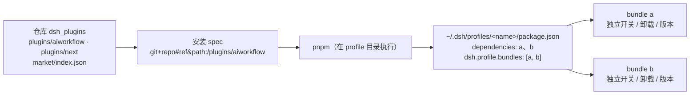

# 多插件仓库改造与文档布局设计

日期：2026-10-30
状态：已实施（2026-10-30；目录、脚本、测试、文档、索引均已按本文落地）
范围：仓库结构、构建/发布脚本、插件市场索引、文档体系、仓库 README
依据：DSH 0.1.5-rc.3 的插件管理器与市场索引实现（本机安装包内 `dsh-plugin-manager`、`dsh-plugin-market-index` 源码与文档）

---

## 1. 结论与依据

**DSH 支持一个仓库多个插件。** 它的安装单位是「一个 npm 包 = 一个 bundle」，不是「一个仓库」：

- 装插件 = 向 profile 的 `package.json` 加一条依赖，并把包名加进 `dsh.profile.bundles`；装 N 个插件就是 N 条依赖，Plugins 页面就是 N 张卡片，各自独立开关、卸载、升级。
- git 子目录安装是公开约定：`git+https://github.com/<user>/<repo>.git#<ref>&path:/<子目录>`。`path:` 是 pnpm 的包目录参数，DSH 市场自己生成的 spec 也是 `git+<url>.git#<commit>&path:/<path>`。
- 市场索引 format 1 是 `{ format, title, description, plugins: [...] }`：一个索引天然列多个插件，每项有自己的 `name`、`versions[]`、`repository.directory` 与 `versions[].source.path`。唯一的唯一性约束是**包名不重复**，同一个仓库 URL 配不同 `path` 完全合法。

因此这次改造**不需要 DSH 侧任何新机制**，只需要把仓库里「一个插件」变成「可枚举的多个插件包」，并把脚本、索引、文档从单插件假设改成循环。



## 2. 目标与非目标

**目标**

1. 插件代码按包分目录，新增插件不改任何共享脚本的分支逻辑。
2. 构建 / 类型检查 / 检查产物 / 发布 / 市场索引全部按目录循环，且仍能只处理单个插件。
3. 一个索引列全部插件；每个插件独立版本、独立 commit 钉点。
4. 每个插件一个文档目录，根 README 与 `docs/README.md` 都链接到它；用脚本保证不遗漏。
5. 存量 aiworkflow 的用户文档、设计文档、测试迁移到位，不丢内容。

**非目标**

- 不改 DSH 本体，不做安装界面，不发 npm registry 包。
- 不把多个功能硬塞进同一个包（是否合并成「一个包多 row」是插件设计问题，见 §11）。
- 不改 aiworkflow 的功能行为。

## 3. 术语

| 词 | 含义 |
|---|---|
| 插件 id | 插件目录名，也是文档目录名，如 `aiworkflow` |
| 插件包 | `plugins/<id>/` 下的一个 npm 包，`package.json` 声明 `dsh.bundle.patch` 与 `dsh.client` |
| bundle | DSH 的加载/开关单位，等于一个插件包 |
| row | 包内 `cordis.patch.yml` 里的一条 loader 条目，可单独开关 |
| 安装 spec | 粘进 Plugins → Add plugin 的字符串，含 `#ref` 与 `&path:/...` |

## 4. 目标目录

```
plugins/
  aiworkflow/           # 插件 1：从 dsh-plugin/ 迁入，包名不变
    package.json        # name/version/exports/files/dsh
    cordis.patch.yml
    locale/{en,zh}.json
    icon.svg
    README.md           # 短版：定位 + 安装 spec + 链到 docs/plugins/aiworkflow/
    src/**              # Host/Client 源码
    index.js            # 构建产物（提交）
    client.js           # 构建产物（提交）
  <next>/               # 插件 2，同样结构
shared/src/             # 构建期内联层（不发包、不作为运行期依赖）
market/index.json       # 一个索引，列全部插件
scripts/
  plugins.mjs           # 枚举 plugins/*，读 package.json
  build-plugin.mjs      # 单插件构建（原 dsh-plugin/build.mjs 泛化）
  build.mjs             # 循环构建
  check-bundles.mjs     # 循环校验产物与暂存区一致
  release.mjs           # 循环发布（构建 → 提交 → 索引 → 打印 spec）
  market.mjs            # 生成 market/index.json
  check-docs.mjs        # 文档完整性校验（§7.8）
  typecheck.mjs         # 循环 tsc
tests/
  support/              # 内存 SQLite 等共用测试设施
  aiworkflow/           # 与插件目录同名的测试目录
docs/
  README.md             # 文档总索引 + 规则
  plugins/
    aiworkflow/
      README.md         # 插件文档入口（必选）
      design.md         # 架构与关键决策（必选）
      editor.md         # 可选主题文档
    <next>/ ...
  dev/                  # 临时文档，规则不变（验收后删除）
```

依赖方向仍是 `plugins/*/ → shared/`；**插件之间不互相 import**（见 §5.4 与层次测试）。

## 5. 插件包契约

### 5.1 必选文件

| 文件 | 作用 |
|---|---|
| `package.json` | 包名、版本、`exports`、`files`、`dsh.bundle.patch`、`dsh.client` |
| `cordis.patch.yml` | bundle 的 loader 行；id 必须带插件前缀 |
| `locale/{en,zh}.json` | 展示名与描述（至少 en） |
| `icon.svg` | 市场与 Plugins 卡片图标 |
| `README.md` | 短版说明，链到 `docs/plugins/<id>/` |
| `index.js` / `client.js` | 提交进仓库的构建产物 |
| `src/**` | Host 半 `src/host.ts`、Client 半 `src/client.tsx` 为默认入口 |

### 5.2 `package.json` 模板

```jsonc
{
  "name": "@aiworkflow/dsh-plugin",       // 决策 Q1：作用域待确认
  "version": "0.1.3",                      // 每个插件独立 semver
  "private": true,                         // 只防误发布；git 安装不受影响
  "type": "module",
  "exports": {
    ".": "./index.js",
    "./client": "./client.js",
    "./locale/*.json": "./locale/*.json",
    "./icon": "./icon.svg"
  },
  "files": ["index.js", "client.js", "cordis.patch.yml", "locale/*.json", "icon.svg", "README.md"],
  "dsh": {
    "bundle": { "patch": "./cordis.patch.yml" },
    "client": { "platform": "web", "immediately": true, "inject": ["@deepseek-ai/dsh-client-ui-conversation"] }
  }
}
```

`private: true` 保留：`npm pack` 不看它，`npm publish` 才拒绝；git 安装不受影响，但发布前要跑一次真机验证（§10）。

### 5.3 命名空间（硬约束）

同一个 profile 里多个插件共享一个加载器树与一张 Web 页面，以下标识必须按插件加前缀，否则会互相覆盖：

| 标识 | 现状（aiworkflow） | 规则 |
|---|---|---|
| bundle 包名 | `@aiworkflow/dsh-plugin` | 全局唯一 |
| loader row id | `aiworkflow-progress` | `<id>-<用途>` |
| Host 路由前缀 | `/aiworkflow` | `/<id>` 或 `/<id>-<子域>` |
| Client slot / 面板 id | `aiworkflow` 系 | `<id>.<用途>` |
| locale 命名空间 | 插件自带 | 不共享 |

### 5.4 运行期依赖

- 只允许 `node:` 内建、宿主注入的 `react` / `react-dom`，以及构进产物的第三方代码。
- `@shared/*` 是构建期 alias，会被内联进每个插件的产物；**不得**把 `shared/` 发布成运行期包，也不得用 `workspace:` / `file:../` 依赖兄弟插件。
- 原因：pnpm 的 git 安装只取 `path:` 指向的那个子目录包，兄弟目录与 workspace 协议在安装端不成立（DSH 的 `plugin_manager` 也是按单包安装）。
- 共享逻辑演进顺序：先留在 `shared/src/` 内联；当第三个插件复用同一块能力、且内联开始明显重复时，再评估抽成正式 npm 包（届时另开设计文档）。

## 6. 安装、版本与市场索引

### 6.1 安装 spec

每个插件一条，形状固定：

```
git+https://github.com/zh880517/dsh_plugins.git#main&path:/plugins/aiworkflow
git+https://github.com/zh880517/dsh_plugins.git#main&path:/plugins/<next>
```

- `#main` 跟分支；钉版本用 40 位 commit（只钉包含构建产物的提交）。
- `&path:/plugins/<id>` 指定包目录。
- 一次安装只处理一个 spec；升级 = Remove 后重装（或换 commit 重装）。这是 DSH 现状，不是本仓库能改的。

### 6.2 索引位置与内容

索引从 `dsh-plugin/market/index.json` 移到仓库根的 `market/index.json`：

- `icon` 用相对索引 URL 的路径：`../plugins/<id>/icon.svg`；
- `repository.url` 为仓库地址，`repository.directory` 为 `plugins/<id>`；
- 每个版本 `source: { type: "git", url, commit, path: "plugins/<id>" }`；
- 同一索引里 `plugins[].name` 必须互不相同（DSH 校验器会拒重复）。

### 6.3 版本规则

- 每个插件独立 semver；**改代码必须 bump 版本**，否则 `release` 拒绝发布（原因：索引里同一插件的 `versions[].version` 不能重复，靠"同版本换 commit"会造成版本号与内容不符）。
- 每个插件版本钉自己的 commit：只改 A 时，B 的最新条目保持旧 commit，不跟着动。
- 历史版本保留，单插件最多保留最近 10 个，防止索引无限膨胀。
- `publishTimestamp` 取该 commit 的时间；`engines.dsh` 从 `package.json.engines.dsh` 透传（可选）。

### 6.4 发布流程

```bash
npm run release:plugin                      # 全部插件：构建 → 提交 → 索引 → 提交索引 → 打印 spec
npm run release:plugin -- --only aiworkflow # 只处理一个插件
npm run release:plugin -- --dry-run         # 只构建、打印步骤
```

脚本步骤：

1. 防呆：`shared/src`、根 `package.json`、锁文件不能有未提交改动（它们决定产物）。
2. 循环构建（`build-plugin.mjs`），产物写回各插件目录。
3. 逐插件校验：有变更但版本号没变 → 报错并指出改哪个 `package.json`。
4. 提交：一笔提交所有变更的插件（源码 + 产物同笔，保证提交内自洽）。
5. 重新生成 `market/index.json`（只为有变化的插件追加版本），单独一笔提交。
6. 打印每个插件的 `#main` spec、钉 commit 的 spec、索引 URL。

### 6.5 存量兼容（已确认不需要）

旧安装链接 `…&path:/dsh-plugin` 在目录迁移后立即失效。**不做兼容层**：

- 目前只有当前这台开发机装了这个插件，没有外部用户，不需要保留 `dsh-plugin/` 空壳或转发包（git 子目录安装只打包该目录，跨目录 re-export 本来也不可靠）。
- 本机当前安装是 `link:D:/GitHub/AIWorkFlow/dsh-plugin`（见 `~/.dsh/profiles/desktop/package.json`），迁移后这个路径不存在，**必须重指向**：改成 `link:D:/GitHub/AIWorkFlow/plugins/aiworkflow` 并保留 bundle 列表条目，或直接在 Plugins 页面 Remove 后按新 spec 重装（测试 git 安装走这条）。
- 旧市场索引 URL（`dsh-plugin/market/index.json`）随之失效，README 只给新 URL。

## 7. 文档体系

### 7.1 原则

1. **一个插件一个文档目录**：`docs/plugins/<id>/`，`<id>` 与 `plugins/<id>` 一一对应。
2. **根 README 是唯一入口**：`## 插件` 表一行一个插件，含文档链接；读者不进 `docs/` 也能找到每个插件的文档。
3. **`docs/` 根只放跨插件文档**：文档规则、共用层契约、仓库级设计；单插件细节不许散落在根目录。
4. **文档不随包安装**：文档只在仓库里，`package.json.files` 不含 `docs/`；包内 README 只做短版与跳转。
5. **机器可校验**：缺文档、缺链接、孤儿文档目录都会让 `npm run check:docs` 失败（§7.8）。

### 7.2 文档目录树

```
docs/
  README.md                     # 总索引：规则 + 插件表 + 跨插件文档
  shared.md                     # 可选：shared/ 的契约与依赖规则
  plugins/
    aiworkflow/
      README.md                 # 必选：插件文档入口
      design.md                 # 必选：架构与关键决策（含 Mermaid）
      editor.md                 # 可选：主题文档（如编辑器交接）
      CHANGELOG.md              # 可选：多版本后建议
    <next>/
      README.md
      design.md
  dev/                          # 临时文档，生命周期结束整体删除
```

### 7.3 每个插件文档目录的最小内容

| 文件 | 必选 | 回答的问题 |
|---|---|---|
| `README.md` | 是 | 这是什么、装哪条 spec、能做什么、边界、怎么开发、文档索引 |
| `design.md` | 是 | 架构、数据流、关键决策与取舍（给维护者） |
| `editor.md` / `flows.md` 等 | 否 | 单主题深入 |
| `CHANGELOG.md` | 否 | 各版本变更；发布多个版本后建议补 |

### 7.4 插件文档 `README.md` 模板

```md
# <插件名>

一句话定位。

## 安装
git+https://github.com/zh880517/dsh_plugins.git#main&path:/plugins/<id>
（钉版本、市场索引、升级方式各一句）

## 能做什么
## 边界与已知限制
## 数据与权限（涉及本地文件/数据库时必写）
## 开发
（本插件的 typecheck/test/build 命令；产物要提交的原因）
## 文档
- 架构与决策：[design.md](./design.md)
- 仓库文档规则：[../../README.md](../../README.md)
```

### 7.5 根 README 结构

```md
# DSH 插件集合（仓库名待定，见 Q3）

一句话：每个插件是独立包，装哪个装哪个；一次装一个。

## 插件

| 插件 | 一句话 | 安装 | 文档 |
|---|---|---|---|
| aiworkflow | 把流程画成图，Agent 一次领一步 | `git+…#main&path:/plugins/aiworkflow` | [docs/plugins/aiworkflow](docs/plugins/aiworkflow/README.md) |
| <next> | … | `git+…#main&path:/plugins/<next>` | [docs/plugins/<next>](docs/plugins/<next>/README.md) |

## 安装
（spec 三段解释；一次一个；升级=Remove 再装；市场索引 URL）

## 开发
（typecheck / test / build / check:plugin / check:docs / release）

## 文档
- 文档索引与规则：[docs/README.md](docs/README.md)
- 每个插件一个文档目录：`docs/plugins/<id>/`（新建插件时必须一起建）
```

aiworkflow 的功能细节（画布、执行、进度、设计思想）从根 README 移到 `docs/plugins/aiworkflow/README.md`；根 README 只留一行摘要。

### 7.6 `docs/README.md` 的规则与索引

| 内容 | 规则 |
|---|---|
| 目录分工 | `docs/` 根 = 跨插件正式文档；`docs/plugins/<id>/` = 单插件文档；`docs/dev/` = 临时 |
| 索引表 | 插件 id、文档入口、代码目录、市场条目 |
| 新增插件 | 必须同时新增 `docs/plugins/<id>/README.md` 与 `design.md`，并在两个 README 各加一行 |

### 7.7 包内 README 与文档目录的分工

- `plugins/<id>/README.md`：短版（定位、安装 spec、一条指向完整文档的相对链接 `../../docs/plugins/<id>/README.md`）。它随包分发，给"已经装到本地、直接翻包目录"的人看。
- `docs/plugins/<id>/README.md`：完整版（功能、边界、数据、开发、文档索引），是根 README 与 `docs/README.md` 指向的目标。
- 两者不复制长段落：包内 README 超过一屏就把内容上移到文档目录。

### 7.8 文档校验脚本

`scripts/check-docs.mjs`（接入 `npm run check:docs`，并由 `npm run check` 串联）：

对每个 `plugins/*/package.json`（排除 `node_modules`）：

1. `docs/plugins/<id>/README.md` 存在；
2. `docs/plugins/<id>/design.md` 存在；
3. 根 `README.md` 至少出现一次 `docs/plugins/<id>/README.md`；
4. `docs/README.md` 至少出现一次同一路径；
5. `market/index.json` 里存在同名条目；
6. `dsh.bundle.patch` 指向的文件存在。

反向检查：`docs/plugins/*` 下每个目录都必须有对应插件包（孤儿文档报错）。

报错文案按仓库习惯给"错在哪 + 正确姿势"，例如：

```
docs/plugins/foo/README.md 缺失。
新增插件 foo 时要同时建 docs/plugins/foo/README.md 与 design.md，
并在根 README「插件」表加一行（模板：docs/plugins/aiworkflow/README.md）。
```

### 7.9 aiworkflow 存量文档迁移映射

| 现状 | 目标 |
|---|---|
| `dsh-plugin/README.md`（12 KB 长文） | 长内容 → `docs/plugins/aiworkflow/README.md`；包内只留短版 |
| `docs/2026-09-02-flowchart-driven-agent-design.md`（48 KB） | `docs/plugins/aiworkflow/design.md`（内容与图不动，只改标题与相对链接） |
| `docs/dev/EDITOR-HANDOFF.md` | 吸收进 `docs/plugins/aiworkflow/editor.md` 后删除（按 `docs/dev` 规则） |
| `docs/dev/PENDING.md`、审计记录 | 不迁移内容；未完成项若无插件归属，留在 `docs/dev/` 到收尾 |

## 8. 工程改造清单

| 文件 | 动作 |
|---|---|
| `scripts/plugins.mjs` | 新增：枚举 `plugins/*/package.json`，导出 `{ id, dir, pkg }` |
| `scripts/build-plugin.mjs` | 由 `dsh-plugin/build.mjs` 泛化：入参插件目录；保留 `@shared` alias、jsx shim、自包含断言、确定性处理 |
| `scripts/build.mjs` | 新增：`--all` 或 `<id>`，循环构建 |
| `scripts/check-bundles.mjs` | 由 `dsh-plugin/check-bundles.mjs` 泛化：循环比较暂存区产物；源码范围按插件目录 + `shared/src` |
| `scripts/market.mjs` | 由 `dsh-plugin/market/build.mjs` 泛化：多条目、每插件独立 commit/版本/历史 |
| `scripts/release.mjs` | 由 `dsh-plugin/release.mjs` 泛化：`--only`、版本 bump 校验、多插件提交、索引提交、spec 打印 |
| `scripts/check-docs.mjs` | 新增：§7.8 规则 |
| `scripts/typecheck.mjs` | 新增：`shared` + 每个插件各跑一次 `tsc` |
| 根 `package.json` | scripts 重写：`build` / `check:plugin` / `check:docs` / `check` / `typecheck` / `test` / `release:plugin` / `market:plugin` |
| `tsconfig.plugin.base.json` | 新增：单插件 tsconfig 继承它，只声明 `include: ["src"]` |
| `tests/<id>/` | 现 `tests/*.test.ts` 迁入 `tests/aiworkflow/`，修相对 import |
| `tests/layering.test.ts` | 泛化：遍历 `plugins/*/src`，禁止越界相对路径与跨插件 import |
| `vitest.config.ts` | `include` 不变（`tests/**/*.test.ts` 已覆盖子目录）；alias 不变 |
| `AGENTS.md` | 更新目录结构、命令、文档规则、依赖红线、新插件 checklist |
| `.gitignore` | 忽略 `plugins/*/.build` |

新插件接入 = 5 步：建 `plugins/<id>/` 包 → 建 `docs/plugins/<id>/{README,design}.md` → 根 README 加一行 → `docs/README.md` 加一行 → 跑 `npm run release:plugin -- --only <id>`。

## 9. 迁移步骤

0. 建分支 `refactor/multi-plugin`；确认工作区干净。
1. **结构**：`mkdir -p plugins`；`git mv dsh-plugin plugins/aiworkflow`；`git mv plugins/aiworkflow/market market`（索引升到根）。
2. **脚本**：迁出 `build.mjs` / `check-bundles.mjs` / `release.mjs` / `market/build.mjs` 到 `scripts/`，改循环参数；删除插件目录里的脚本；根 `package.json` 更新 scripts。
3. **测试**：`mkdir -p tests/aiworkflow`；`git mv tests/*.test.ts tests/aiworkflow/`；修 import 到 `../../plugins/aiworkflow/src/...`；改 `tests/layering.test.ts`。
4. **文档**：建 `docs/plugins/aiworkflow/`；按 §7.9 迁移三份文档；新建插件文档 README。
5. **README**：根 README 改插件集合版（§7.5）；`docs/README.md` 改规则与索引。
6. **索引**：`npm run market:plugin` 生成 `market/index.json`，提交。
7. **规则**：更新 `AGENTS.md`；补 `check:docs`。
8. **本机重指向**：把 `~/.dsh/profiles/desktop/package.json` 里的
   `"@aiworkflow/dsh-plugin": "link:D:/GitHub/AIWorkFlow/dsh-plugin"` 改成
   `link:D:/GitHub/AIWorkFlow/plugins/aiworkflow`（bundle 列表条目不动），重开 DSH 验证；
   或直接 Remove 后按新 spec 重装，顺便验证 git 安装路径。
9. **验收**：按 §10 全部跑绿；提交。

每一步都能单独构建与回滚；产物与源码同笔提交，`git revert` 可回到单插件形态。

## 10. 验收标准

- [ ] `npm run typecheck`：`shared/` 与每个 `plugins/*` 都通过。
- [ ] `npm test`：原有用例全绿（路径迁移后）。
- [ ] `npm run build`：所有插件产物生成；连跑两次哈希一致。
- [ ] `npm run check:plugin`：每个插件产物与暂存区一致。
- [ ] `npm run check:docs`：文档、README 链接、索引条目齐全；人为删一份文档会失败并给出修复文案。
- [ ] `market/index.json`：`format: 1`、`plugins[].name` 唯一、`source.path` 与 `repository.directory` 都存在、`icon` 可从索引 URL 解析。
- [ ] 本机安装：profile 依赖改指 `plugins/aiworkflow`（或按新 spec 重装）后，插件正常加载，Plugins 页面卡片可开关。
- [ ] 多插件真机：再加一个最小测试插件，两张卡片各自开关/卸载互不影响；确认后移除测试插件。

## 11. 风险与开放问题

| 风险 | 影响 | 对策 |
|---|---|---|
| 目录迁移让本机 `link:` 失效 | 迁移后当前 DSH 启动即缺插件 | 迁移步骤 §9.8 明确重指向；迁移与重指向在同一次操作里完成 |
| 每个插件各自内联 `shared/` | 产物体积重复 | 可接受；第三个插件复用明显时再抽包 |
| 多插件共享页面 | slot / 路由 / row id 冲突 | §5.3 命名空间 + code review + 层次测试 |
| 索引无限增长 | 市场读取变慢 | 单插件保留最近 10 版 |
| 一次安装一个包 | 无法"一键全装" | README 明说；需要时提供一串 spec 供粘贴 |
| `private: true` 与 git 安装 | 若某些 pnpm 版本拒绝打包私有包 | 发布前真机验证；失败则去掉 `private`，改用发布脚本拦截 |

**待确认决策**

| 编号 | 问题 | 结论 |
|---|---|---|
| Q1 | 新插件的 npm scope：继续 `@aiworkflow/*`，还是换成 `@<owner>/dsh-*` | 待定：现有 `@aiworkflow/dsh-plugin` 不动（改名会迫使所有用户重装）；第二个插件落地前确定统一 scope |
| Q2 | 文档放 `docs/plugins/<id>/`（集中）还是 `plugins/<id>/docs/`（跟随代码） | 已定：集中式 `docs/plugins/<id>/`，已落地 |
| Q3 | 仓库是否改名（原名 AIWorkFlow，但要做插件集合） | 已定（2026-10-30）：GitHub 仓库改名为 `dsh_plugins`；本地目录仍是 `D:\GitHub\AIWorkFlow`，profile 的 `link:` 指向它，不受改名影响。旧 URL 由 GitHub 重定向，市场索引与 README 已换新地址 |

## 12. 决策记录（拟）

- **D1** 安装单位是插件包，不是仓库；一个仓库 N 个包 = N 次安装。
- **D2** 插件目录名 = 文档目录名 = 索引里的 `<id>` 段。
- **D3** 脚本按目录循环，单插件操作靠 `--only <id>` / 位置参数，不做每插件一条 npm script。
- **D4** 每个插件独立 semver，改代码必须 bump；索引保留历史（上限 10）。
- **D5** 文档集中放 `docs/plugins/<id>/`，根 README 与 `docs/README.md` 双入口，`check:docs` 兜底。
- **D6** 运行期不跨插件依赖；共享代码只在构建期内联。
- **D7** 一次性迁到新目录，**不做旧安装链接 / 旧索引 URL 的兼容层**（已确认：目前只有当前开发机装了本插件，且是 `link:` 本地安装，迁移时重指向即可）；README 只保留新 spec。
