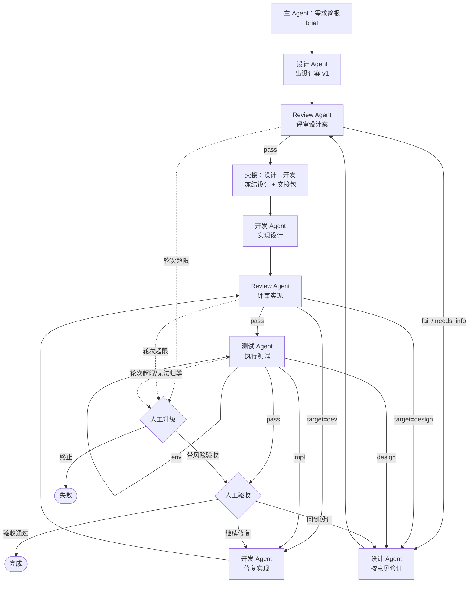

# 子 Agent 协作工作流 — 扩展设计方案（P1 已完成，P2 内嵌子图）

日期：2026-10-29
状态：**已评审；P1 已完成（角色/线程/产物/when/inputs），P2 内嵌子图、运行图层级、评审/测试模板、loopId/maxRounds 已落地**。评审结论：采用方案 A（父级中转）。评审通过的部分回写 `docs/2026-09-02-flowchart-driven-agent-design.md`，本文按 `docs/dev/` 约定在阶段结束后删除。
基线：当前 v9 引擎 + 六种节点 + 已构建产物。

> 决策记录（2026-10-29）：Review 与 Design 是同级子 Agent，当前全局 `send_message` 只允许父→直接 child / 驻留 child→直接 parent，同级不能直投；确认**不引入 experimental Agent Teams**，P1 采用父级中转（Review → 主 Agent → Design/开发）。Agent Teams 直连保留为 P3 可选，不进 P1。

---

## 0. 结论先行

1. **这个场景不需要先加五种新节点。** 真正的缺口在引擎语义：子 Agent 的 `payload` 回不到父级、`subagent` 节点的分支被忽略、链式 `subagent` 不会立刻派发、跨轮次没有角色记忆与产物版本。这四条不补，画什么节点都只是把问题挪个地方。
2. 推荐形态：**编排者中转（orchestrator relay）+ 角色线程（thread）+ 产物总线（artifact bus）**。主 Agent 只做派发、转交、路由、升级，不替任何子 Agent 写内容。
3. **消息能力分三档，不能笼统说“子 Agent 不能互发”。** 当前会话的全局 `send_message` 只允许**直接父子**（父→直接可继续 child；驻留 child→直接 parent），同级 Review↔Design **不能直接互发**；实验性的 Agent Teams 允许任意成员互发，但当前会话未启用；插件自建 broker 仍受相邻关系约束，除非由主 Agent 作为 sender 转发。v1 因此仍用**编排者中转**，把“交互”定义成**轮次 + 产物**；直连是 P3 的可选升级，不是前提。
4. 分三期：P1 补四条引擎语义 + 角色/线程/产物；P2 再考虑 `review` 宏节点与 `join` 的 any/quorum；P3 再评估启用 Agent Teams 做同级直连。
5. 已用**现有能力**建了一张基线图：`f_agent_team_v0`（16 节点）。它已保存并通过当前校验（只有 `triage` 一条环上无上限的 warning），按 v6 语义可跑；尚未实机跑完整条。主 Agent 要在三个“路由”节点上读文件、判断结论——这正好量化了 P1 要省掉的注意力开销。

**一句话**：先把 `subagent` 变成“带角色、有记忆、结果可路由”的一等公民；`review` 节点是可选糖，不是前提。

---

## 1. 场景拆解

### 1.1 角色

| 角色 | 职责 | 明确不做 | 主要产出 |
|---|---|---|---|
| 主 Agent（编排者） | 接需求、澄清、派发、转交、按结论路由、遇上限升级人工 | 不写设计、不改代码、不替 Review 下结论、不替子 Agent 回答 | 交接包、路由决策、人工卡点 |
| 设计 Agent | 出设计案、按 Review 意见修订、回答设计澄清 | 不改代码、不给自己判 pass | `design` 产物（设计文档 + 决策/风险/未决问题） |
| Review Agent | 评审设计案与实现，输出结论与问题清单 | 不改设计、不改代码、不合并修复 | `design_review` / `code_review` 产物 |
| 开发 Agent | 按设计实现、按 Review/测试反馈修复 | 不擅自改设计；设计缺口只能上报 | `code` 产物（改动文件、diff 摘要、验证命令） |
| 测试 Agent | 按验收标准执行测试，失败归类 | 不改代码、不改设计 | `test_report` 产物（结论、失败类型、复现证据） |

> Review 是**独立角色**。让设计或开发兼任 Review 会同时损失客观性和上下文隔离；代价是多一轮派发，这个代价值得。

### 1.2 产物（handoff 的载体）

| key | 生产者 | 消费者 | 说明 |
|---|---|---|---|
| `brief` | 主 Agent | 设计/开发/测试 | 目标、验收标准、约束、非目标 |
| `design` | 设计 Agent | Review、开发、测试 | 设计文档路径 + 决策/风险/未决问题；每轮一个新版本 |
| `design_review` | Review Agent | 设计、主 Agent | `verdict` + `issues[]` + 报告路径 |
| `code` | 开发 Agent | Review、测试 | 改动文件、diff 摘要、验证命令、设计缺口 |
| `code_review` | Review Agent | 开发、主 Agent | 同上，`issues[].target` 可指向 `dev` 或 `design` |
| `test_report` | 测试 Agent | 开发、设计、主 Agent | `verdict`、`failureKind`（`impl`/`design`/`env`）、证据 |

**产物以文件为准**：设计文档、review 报告、测试报告都落在工作区文件里；SQLite 只存 `key + version + path + summary + 可选 content 快照`。理由：文件是 Agent 真正会读的东西，SQLite 存全文会迅速膨胀，还会和文件版本打架。

### 1.3 交互协议

“Review 和设计、开发交互”不建模成实时对话，而是**结构化的轮次**：

```jsonc
// Review 结论（complete_step 的 payload）
{
  "verdict": "pass | fail | needs_info",
  "issues": [
    {
      "id": "D-1",
      "severity": "blocker | major | minor",
      "target": "design | dev",
      "where": "接口定义 / 文件:行 / 设计章节",
      "message": "问题是什么",
      "suggestion": "建议怎么改"
    }
  ],
  "summary": "verdict=fail; report=docs/review/x-design-r2.md; blocker=1 major=2"
}
```

```jsonc
// 测试结论
{
  "verdict": "pass | fail | blocked",
  "failureKind": "impl | design | env | null",
  "report": "docs/test/x-latest.md",
  "summary": "verdict=fail; failureKind=design; report=...; 失败 3 例",
  "evidence": ["命令", "环境", "复现步骤"]
}
```

三条硬规则：

1. **结论必须结构化**。自然语言条件仍可用于普通分支，但 Review/测试的出口必须能被机器判定，否则每次路由都靠主 Agent 猜。
2. **问题必须带 `target`**。`target=design` 和 `target=dev` 决定回哪条回路；没有 target 的 issue 视为 `dev`，并在 summary 里注明。
3. **主 Agent 只转交，不改写**。Review 说三条，就原样把三条交给设计/开发；编排者可以补上下文，不能替子 Agent 决定“这条其实不用改”。

“通知开发”也走同一套：设计通过 Review 后，主 Agent 生成一个**交接包**（`design` 最新版本 + Review 结论 + 风险 + 实现顺序），下一个节点才是开发派发。通知不是一个新节点，而是“上一步的产物成为下一步的输入”这个事实。

### 1.4 四条回路

| 回路 | 入口 | 通过出口 | 失败回边 | 默认轮次上限 | 超限出口 |
|---|---|---|---|---|---|
| 设计评审 | 设计出稿 | 设计冻结 → 交接开发 | Review→设计修复→再评审 | 3 轮 | 人工升级 |
| 实现评审 | 开发完成 | 进入测试 | Review→开发修复→再评审 | 4 轮 | 人工升级 |
| 测试反馈 | 测试执行 | 人工验收 | `impl`→开发修复；`design`→设计修复（重走设计评审→开发→评审→测试）；`env`→重跑测试 | 4 轮 | 人工升级 |
| 人工验收/升级 | 测试通过或轮次耗尽 | 完成 | 人工选择回开发/回设计 | — | 终止 |

关键点：**测试发现设计问题，不能只回设计改文档就结束**。设计改完必须重新过设计评审，再让开发按新设计对齐实现，再评审、再测试。所以 `test(design)` 的边指向 `design_fix`，而 `design_fix` 的下一条是 `review_design`，不是 `dev_fix`。

---

## 2. 目标流程图



对应的时序（“交互”实际长这样）：

```mermaid
sequenceDiagram
  participant U as 用户
  participant O as 主 Agent（编排）
  participant D as 设计 Agent
  participant R as Review Agent
  participant V as 开发 Agent
  participant T as 测试 Agent

  U->>O: 需求
  O->>D: brief + 设计任务
  D-->>O: design v1（文件 + payload）
  O->>R: design v1 + 评审标准
  R-->>O: fail; issues[target=design]
  O->>D: issues 原样转交 + 修订任务
  D-->>O: design v2
  O->>R: design v2（复审）
  R-->>O: pass
  Note over O: 交接包 design v2 → dev
  O->>V: 设计 + 交接说明
  V-->>O: code v1
  O->>R: code v1 + design v2
  R-->>O: fail; issues[target=dev]
  O->>V: issues 原样转交
  V-->>O: code v2
  O->>R: code v2（复审）
  R-->>O: pass
  O->>T: design v2 + code v2 + 验收标准
  T-->>O: fail; failureKind=design
  O->>D: 测试报告 + 设计变更任务
  D-->>O: design v3
  O->>R: design v3
  R-->>O: pass
  O->>V: 对齐 design v3，重新实现
  V-->>O: code v3
  O->>R: code v3
  R-->>O: pass
  O->>T: 回归测试
  T-->>O: pass
  O->>U: 验收摘要
```

> 图里没有“Review 直接发消息给设计”的箭头，因为当前会话的全局 `send_message` 只允许直接父子，Review 和 Design 是同级。Review 的“交互”体现在：它出的 `issues` 被原样送到设计/开发，修完后同一 Review 角色在下一轮拿到旧问题清单做复审。这是**轮次交互**，不是实时聊天。若启用实验性 Agent Teams，这条箭头可以补上（见 §4.9）；协议不变，仍以 `verdict/issues` 为准。

---

## 3. 现有能力盘点

### 3.1 已经够用的

- 六种节点、`subagent` 的 `inline/subflow/flowRef` 三态、`fanOut`、`join`、`gate`、`iterationLimit`/`onLimitExceeded`、`maxSteps`。
- `{{节点.payload.字段}}` 插值、`summary` 给人看/`payload` 给机器用、copy-on-run 快照、自愈式报错。
- 面板的运行图、轨迹、卡点只读展示。

### 3.2 四个硬缺口（按严重程度）

#### G1. 子 Agent 的 `payload` 回不到父级

`gatherChildren` 写父节点轨迹时只放 `{ children: results }`，而 `results` 来自 `childResultOf`，只有 `{ childToken, status, summary }`：

```ts
// shared/src/engine.ts:852-861
const results = slots.map((s) => this.childResultOf(s.latest));
const sRow = { ..., payload: JSON.stringify({ children: results }), ... };
```

```ts
// shared/src/engine.ts:964-966
private childResultOf(child: RunRow) {
  return { childToken: child.child_token ?? '', status: child.status, summary: this.childSummaryOf(child.id) };
}
```

后果：Review 子 Agent 返回的 `verdict`、`issues` 在父级完全拿不到。父级只能看到 `summary`，于是 `{{review_design.payload.verdict}}` 永远是 `undefined`，插值只保留原 token。当前唯一的绕过是：子 Agent 把完整结论写进文件，`summary` 里放文件路径，父级再读文件。

#### G2. `subagent` 节点的分支被忽略

`gatherChildren` 推进时直接取 `node.next`，完全不看 `node.branches`：

```ts
// shared/src/engine.ts:863-867
const successorId = node.next ?? null;
const plan: AdvanceOutcome = successorId === null
  ? { kind: 'advance', targetId: null, limitRows: [] }
  : this.resolveAdvance(run, snapshot, successorId);
```

后果：不能在 `subagent` 节点上写“评审通过 → 开发 / 评审不通过 → 设计修复”。更糟的是，如果这个 `subagent` 节点只写了 `branches` 而没写 `next`，`successorId` 为 `null`，父 run 会**直接按隐式 end 收尾**——图看起来有出口，实际跑起来流程悄悄结束。要么再加一个 `prompt` 路由节点（v0 就是这么绕的），要么把分支写在一个不会被执行的地方。这是场景最核心的缺口。

#### G3. 链式 `subagent` 不会立刻派发

只有 `completeStep` 在推进事务提交后补建 child：

```ts
// shared/src/engine.ts:392-414
// 推进到派发步……现在建 child(ren)
if (plan.kind === 'advance' && plan.targetId !== null) { ... this.spawnChildren(...) }
```

`gatherChildren`（子 Agent 完成后汇聚）、`answerGate`（人工卡点选项指向 subagent）、`reportBlocked`（逃生出口指向 subagent）都只把父 run 置为 `waiting_children`，不建 child。下一次 `get_current_step` 走到 `gatherChildren` 的“崩溃窗口自愈”分支才惰性补建。

后果：`design_fix -> review_design` 这种 subagent 直连 subagent 的边，要多调一次 `get_current_step` 才拿到 `children[]`。能用，但多一次往返，而且对 Agent 来说“这一步没有 child 却让我派发”很困惑。

#### G4. 跨轮次没有角色记忆与产物版本

`SubagentNode` 只有 `extraPrompt/mode/subflow/flowRef/fanOut`，没有角色、线程、产物声明：

```ts
// shared/src/types.ts:59-68
export interface SubagentNode extends FlowNodeBase {
  type: 'subagent';
  extraPrompt: string;
  mode: SubagentMode;
  subflow?: SubflowDef;
  flowRef?: string;
  fanOut?: FanOutConfig;
}
```

后果：

- 同一个设计 Agent 在第 2、3 轮被重新派发时，是一个全新的 child run，没有“我上一轮改了什么”的记忆。只能靠主 Agent 在 `extraPrompt` 里重新贴一遍上下文——主 Agent 的注意力预算被反复消耗。
- 多节点产出同一个产物（`design` 初稿 vs `design_fix` 修订）时，`{{design.payload.designDoc}}` 永远指向初稿，拿不到最新版；`{{design_fix.payload...}}` 又只在修过之后才存在。
- 面板看不到“设计 Agent 第 2 轮”“Review 第 1 轮”这种线程视图，只能看扁平的节点轨迹。

### 3.3 软缺口

| 缺口 | 现状 | 影响 |
|---|---|---|
| `start_run.inputs` 未使用 | `StartRunParams` 有 `inputs`，引擎忽略 | 需求参数只能塞进第一个 prompt 节点 |
| preamble 没有角色/线程 | 固定三行 + token | 子 Agent 不知道自己是谁、第几轮 |
| `join` 只有 all | `waitFor` 缺省等全部 child | 并行评审要等最慢的；any/quorum 做不了 |
| `subagent` 无法按结果分支 | 见 G2 | 只能加路由 prompt 节点 |
| 面板没有线程/产物视图 | 只按 run 树折叠 | 多轮评审的“轮次”看不出来 |
| 子 Agent 结果没有 `payload` 视图 | `childResults` 只有 summary | 排障时要翻子 run 的轨迹 |

### 3.4 结论

当前 DSL **能表达**这个场景（v0 已经建出来了），但表达得很别扭：每个评审回路都要多一个 `prompt` 路由节点，主 Agent 要读报告文件、自己判断 verdict、自己把 issues 转交。P1 要做的不是“加节点”，而是把这四个语义补上，让图回到“一个 Review 节点 + 两条分支”的自然形态。

---

## 4. 扩展设计

### 4.1 三条主线

1. **角色线程（role & thread）**：子 Agent 有身份、有跨轮记忆；记忆只给压缩摘要，不给全文。
2. **产物总线（artifact bus）**：所有交接走带版本的产物 key；`{{artifacts.design.path}}` 永远拿最新版。
3. **结果路由（result routing）**：`subagent` 节点可以按子 Agent 的结构化结论分支；能机器判定的用 `when`，剩下的才交给主 Agent 判断。

三者合起来，图上的 Review 节点才会长成这样：

```jsonc
{
  "id": "review_design",
  "type": "subagent",
  "role": "review",
  "thread": "role",
  "extraPrompt": "评审 {{artifacts.design.path}}……",
  "branches": [
    { "id": "pass", "condition": "设计通过", "when": "{{review_design.payload.verdict}} == 'pass'", "to": "handoff_dev" },
    { "id": "fix",  "condition": "设计要改", "when": "{{review_design.payload.verdict}} == 'fail'", "to": "design_fix" },
    { "id": "info", "condition": "需要澄清", "when": "{{review_design.payload.verdict}} == 'needs_info'", "to": "design_fix" },
    { "id": "d",    "condition": "*", "to": "triage" }
  ],
  "iterationLimit": 6,
  "onLimitExceeded": "triage"
}
```

### 4.2 DSL 扩展

#### 4.2.1 Flow 级角色表

```jsonc
{
  "id": "f_agent_team",
  "name": "多 Agent 协作",
  "entry": "brief",
  "agents": [
    {
      "id": "design",
      "name": "设计 Agent",
      "charter": "你负责设计案。你不改代码、不给自己判 pass。完成标准：开发只看设计案就能开工。",
      "produces": ["design"],
      "consumes": ["brief", "design_review"]
    },
    {
      "id": "review",
      "name": "Review Agent",
      "charter": "你只评审，不改设计、不改代码。结论必须结构化：verdict + issues[target]。",
      "produces": ["design_review", "code_review"],
      "consumes": ["design", "code"]
    }
  ],
  "nodes": [ ... ]
}
```

- `id` 在图内唯一；`subagent.role` 引用它。
- `charter` 是**一次编写、每轮注入**的角色章程；节点只写本轮任务，不重复角色设定。这是省主 Agent 注意力预算最直接的一招。
- `produces/consumes` 只用于校验和面板展示，运行时不强制；不写也能跑，只是少了静态提示。
- **不把模型、工具白名单、温度写进角色表**。这些是宿主/会话级配置，写进图会迅速和宿主版本脱节，也超出“流程图描述何时披露什么”的定位。

#### 4.2.2 `subagent` 新增字段

```ts
interface SubagentNode extends FlowNodeBase {
  type: 'subagent';
  extraPrompt: string;
  mode: SubagentMode;
  subflow?: SubflowDef;
  flowRef?: string;
  fanOut?: FanOutConfig;

  /** 角色 id，引用 flow.agents；省略 = 无角色（兼容老图） */
  role?: string;
  /** new（默认，一次性）| role（同角色共享线程）| 自定义线程 key */
  thread?: 'new' | 'role' | string;
  /** 声明本轮产出/消费的产物 key；校验与面板用，运行时不强制 */
  produces?: string[];
  consumes?: string[];
  /** 给子 Agent 的汇报契约（自然语言即可），会拼进 preamble */
  reportHint?: string;
}
```

语义：

- `role` 存在时，preamble 增加角色块：`[角色] 设计 Agent（role=design）` + `[章程] ...`。
- `thread` 为 `role` 时，线程 key = `role`；自定义字符串则跨角色共享（例如 `design-review` 让 Review 看到设计的轮次摘要）。
- `thread !== 'new'` 时，引擎注入**线程摘要**（见 4.3.4），只给最近 5 轮的 `summary + 产物 key + 未决问题`，上限 1200 字符；不给全文。
- `produces/consumes` 不参与运行；校验器只在“消费者引用的 key 在整张图里没有生产者”时给 warning。

#### 4.2.3 `Branch.when`（确定性分支）

```ts
interface Branch {
  id: string;
  condition: string;
  to: string;
  outlet?: string;
  /** 可选：服务端可判定的条件；命中则不靠 Agent 选 branchId */
  when?: string;
}
```

`when` 语法（v1 只做单比较，不做布尔组合）：

```
{{expr}} == 'pass'
{{expr}} != 'fail'
{{expr}} contains 'design'
{{expr}} in 'design,dev'
{{expr}} > 3
{{expr}} truthy
{{expr}} empty
```

- 左值必须是 `{{...}}` 插值；右值是字符串/数字/布尔/null，或另一个插值。
- 求值顺序：所有 `when` 按分支声明顺序求值，**第一个命中**的胜出；都不命中才回落到 Agent 的 `branchId`；再不行走 `condition: "*"`。
- 有 `when` 的分支不再下发给 Agent 让它选；下发的 `branches[]` 只保留自然语言分支，并在 note 里说明“另有 N 条自动分支由服务端判定”。这是降噪，不是保密。
- 校验：`when` 解析失败 → 硬拒 `E_BAD_WHEN`；同一节点多个 `when` 可能同时命中 → warning `W_WHEN_OVERLAP`（不硬拒，因为可能是有意的优先级）。
- 为什么值得：Review/测试的结论是结构化的，让 LLM 再“判断一次”只会引入不必要的非确定性。自然语言分支仍然保留给“需要 Agent 理解语义”的普通节点。

#### 4.2.4 `join` 扩展（P2）

```ts
interface JoinNode extends FlowNodeBase {
  type: 'join';
  waitFor?: string;
  /** all（默认）| any | quorum */
  mode?: 'all' | 'any' | 'quorum';
  quorum?: number;
  aggregateInstruction: string;
}
```

- `any`：第一个 child 到终态就推进，其余 child 继续跑（不杀），面板显性列出“未等待的还有 N 个”。
- `quorum`：N 个到终态就推进，同样列出未等待的。
- 不静默丢弃：推进时的 `summary/payload` 必须带 `waited` 与 `stillRunning` 两份名单。

这个场景的主线是串行，`join` 扩展不是 P1 必需；但如果 Review 要拆成“设计评审 + 安全评审”并行，就会用到。

#### 4.2.5 `review` 宏节点（P2，可选）

如果 P1 之后发现“Review 节点 + 4 条 when 分支 + 轮次上限”在每张图里重复，再引入：

```ts
interface ReviewNode extends FlowNodeBase {
  type: 'review';
  reviewer: string;              // role id
  target: string | string[];     // artifact key 或 {{...}}
  rubric: string;                // 评审标准
  passTo: string;
  fixTo: string;
  maxRounds?: number;
  onExceeded?: string;
  /** 可选多路结论；不写则只有 pass/fix */
  verdicts?: Array<{ id: string; label: string; when: string; to: string }>;
}
```

它本质上是“派一个 reviewer → 校验 verdict → 按结论路由 → 轮次计数”的宏。**不建议 P1 就加**：它会同时增加 types / validate / engine / editor / runview / tests 六个面的表面积，而 P1 的 `subagent + when + role` 已经能表达同样的语义。先用**编辑器模板**（“评审回路”“测试回路”）降低画图成本，等模板真的不够用了再升级成节点类型。

### 4.3 引擎改动

#### 4.3.1 子结果回传与合并

`childResultOf` 增加 `payload`：

```ts
private childResultOf(child: RunRow) {
  return {
    childToken: child.child_token ?? '',
    status: child.status,
    summary: this.childSummaryOf(child.id),
    payload: this.childPayloadOf(child.id),   // 新增：最后一条 completed 轨迹的 payload
    role: child.role ?? null,
    thread: child.thread_id ?? null,
  };
}
```

父节点轨迹的 payload：

```jsonc
{
  "children": [ { "childToken": "...", "status": "completed", "summary": "...", "payload": { ... } } ],
  "child": { ... },          // 单 child 时的便捷视图
  "...": "单 child 时把 child payload 的顶层字段平铺进来（保留键 children/child 除外）"
}
```

平铺是为了让 `{{review_design.payload.verdict}}` 这种最自然的写法能用；保留键避免和聚合结构打架。文档里要写清楚这条规则。

`StepView.childResults` 同步增加 `payload`，面板与 `join` 都能看到。

#### 4.3.2 `subagent` 结果路由

这是 G2 的修法，分三步：

1. `getCurrentStep` 在 `waiting_children` 且当前节点**有分支**时，不再自动推进，而是返回一个“路由步”：
   ```jsonc
   {
     "step": {
       "nodeId": "review_design",
       "kind": "subagent",
       "childResults": [ ... ],
       "branches": [ { "id": "fix", "condition": "设计要改" } ],
       "instruction": "子任务已回报，选一个分支后 complete_step。"
     },
     "note": "有 2 条自动分支由服务端判定，未下发。"
   }
   ```
   如果所有 `when` 已经能判定，则直接自动推进，不返回路由步。
2. `completeStep` 在 `waiting_children` 且节点有分支时接受 `branchId`：先确认所有 child 已终态，再写父节点轨迹（`payload` 含 children + 合并结果），按 `branchId` 定位后继并推进。子任务还没回报时自愈返回“还有 N 个未回报”。
3. 无分支的 `subagent` 保持现状：`next` 自动推进。这样老图零改动。

关键约束：`completeStep` 不能借这个口子跳过子 Agent 的结果——它只负责“选出口”，父节点轨迹的 `payload` 仍然来自 child 的终态。

#### 4.3.3 统一“进入后继”时的派发

把 `completeStep` 里“推进后若目标是 subagent 就建 child”的逻辑抽成一个幂等 helper：

```ts
private ensureChildrenSpawned(runId: string, nodeId: string): void
```

在 `completeStep`、`gatherChildren`、`answerGate`、`reportBlocked` 四条推进路径提交事务后都调用。它检查：run 仍是 `waiting_children`、当前节点是 subagent、该节点还没有 child 槽位；满足才建。这样：

- `design_fix -> review_design` 一次 `get_current_step` 就拿到 `children[]`；
- `gate -> dev_fix` 不再出现“空派发步”；
- 原有的惰性补建保留为崩溃窗口兜底，不再是正常路径。

补两条回归测试：`subagent -> subagent`、`gate -> subagent`。

#### 4.3.4 线程摘要

`runs` 增加 `thread_id`、`role`。`planChild` 时：

- `thread_id = node.thread === 'role' ? node.role : node.thread`（`new`/省略 = null）；
- 子 run 落 `role = node.role`。

派发时构造摘要（只查同一 `root_run_id + thread_id` 下最近 5 个终态 child）：

```
## 同一角色线程的历史轮次（只给摘要，不含全文）
- 第 1 轮 design：设计案 v1 已产出（artifacts.design@1）；未决 2 项。
- 第 2 轮 design_fix：按 3 条 review 意见修订（artifacts.design@2）；关闭 2 项，保留 1 项。
最近一次结论：…（最后一条 summary）
更早的 7 轮已省略。
```

约 1200 字符封顶；超出先丢最旧的，再压每条到一行。**不注入完整 payload、不注入设计文档正文**——正文让子 Agent 自己读文件，摘要只负责“你之前做过什么、现在到第几轮”。

#### 4.3.5 产物总线

`complete_step` 增加可选 `artifacts`：

```jsonc
{
  "summary": "设计案 v2：补齐异常流程",
  "payload": { "verdict": "pass" },
  "artifacts": [
    { "key": "design", "summary": "设计案 v2", "path": "docs/design/x.md", "content": "可选，<=8KB" }
  ]
}
```

引擎在一个事务里：写 `node_executions` → 为每个 artifact 算 `version = max+1` → 写 `run_artifacts`。`root_run_id` 取 run 的根，child 产出自动归到主 run 名下。

插值：

- `{{artifacts.design.path}}` / `.summary` / `.version` / `.nodeId` / `.role`；
- 不带字段时返回 `path`（没有 path 则返回 summary）；
- 找不到 key 时保留原 token（与现有 `{{node.payload.x}}` 一致，让缺什么一眼可见）。

#### 4.3.6 `inputs` 接线

`start_run.inputs` 落 `runs.inputs`（JSON），插值支持 `{{inputs.feature}}`，child 继承。用途：需求参数、仓库路径、验收标准不必挤进第一个 prompt 节点。实现很小，但能显著缩短图。

#### 4.3.7 preamble

在现有三行之后、主 Agent 补充说明之前，插入角色与线程：

```
[以下三行由流程引擎提供，请原样前置，不要改写或摘要]
你是流程 run_x 节点 review_design 派出的子任务，你的 childToken 是 c_x。
调 get_current_step({childToken:"c_x"}) 取你这一步要做什么。
做完调 complete_step({childToken:"c_x", summary, payload?, branchId?})。
[角色] Review Agent（role=review）
[线程] review（本轮第 2 轮）
[章程] 你只评审，不改设计、不改代码……
[历史摘要] ……
[主 Agent 的补充说明写在这行之后]
```

子 Agent 仍然只靠 `childToken` 定位；角色/线程是**展示与记忆**，不是第二套身份。

### 4.4 存储（v7 / v8 / v9）

只追加，不改历史迁移。

```sql
-- v7：角色线程 + run 输入
ALTER TABLE runs ADD COLUMN role TEXT;
ALTER TABLE runs ADD COLUMN thread_id TEXT;
ALTER TABLE runs ADD COLUMN inputs TEXT;
CREATE INDEX idx_runs_thread ON runs(root_run_id, thread_id, created_at);

-- v8：产物总线
CREATE TABLE run_artifacts (
  id INTEGER PRIMARY KEY AUTOINCREMENT,
  root_run_id TEXT NOT NULL,
  key TEXT NOT NULL,
  version INTEGER NOT NULL,
  run_id TEXT NOT NULL,
  node_id TEXT NOT NULL,
  role TEXT,
  summary TEXT,
  path TEXT,
  content TEXT,
  created_at TEXT NOT NULL,
  UNIQUE(root_run_id, key, version)
);
CREATE INDEX idx_artifacts_root_key ON run_artifacts(root_run_id, key, version DESC);

-- v9：同一 subagent 节点在回路里多轮派发，用父节点执行轮次区分“本轮 child”
ALTER TABLE runs ADD COLUMN parent_iteration INTEGER;
CREATE INDEX idx_runs_parent_iteration ON runs(parent_run_id, parent_node, parent_iteration);
```

`runs.parent_iteration` 是**派发该 child 的父节点执行轮次**（从 1 开始）。回路里同一个 `subagent` 节点会被执行多次，如果只按 `(parent_run_id, parent_node)` 取 child，第二轮会把第一轮的旧 child 一起卷进汇聚，导致：
- 第二轮 `get_current_step` 仍返回旧 childToken；
- `when` 用第一轮 payload 判定，路由错；
- 产物版本不递增（第二轮 child 根本没被派出去）。

因此 `childSlots` / `currentWave` 都只取**最大 `parent_iteration` 的那一批**；`ensureChildrenSpawned` 也按 `execCount(node)+1` 判断本轮是否已派过。重派（`retry_of`）沿用原 child 的 `parent_iteration`，所以重派仍算同一轮。

另：`when` 求值发生在父节点轨迹落库**之前**，所以 `{{review.payload.verdict}}` 不能从 `node_executions` 里读。引擎在 `gatherChildren` / `completeSubagentRoute` 把本轮合并后的 child payload 作为 `resolveBranch` 的 override 传入，`lookupExpr` 优先命中 override；普通节点执行时则用本次 `complete_step` 的 `payload` 作为 override。

`flow_snapshots` 不用改：`agents` 和新增字段都在 Flow 里，随快照一起钉死。

### 4.5 工具契约

P1 不新增工具，只加参数：

| 工具 | 变化 |
|---|---|
| `aiworkflow_start_run` | `inputs?` 真正生效；返回里带 `role/thread` 提示 |
| `aiworkflow_get_current_step` | 子 Agent 的 step 带 `role/thread`；父 Agent 在路由步拿到 `childResults[].payload` + `branches` |
| `aiworkflow_complete_step` | `artifacts?`；`subagent` 路由步允许 `branchId` |
| `aiworkflow_report_blocked` | 不变；若当前在路由步，自愈提示“先选分支或再等 child” |
| `aiworkflow_flow` | DSL hint 补 `agents/role/thread/produces/consumes/when`；validate 返回新错误码 |

纪律文本（`DISCIPLINE_TEXT`）追加一段多 Agent 规则：

> 你是编排者，不是作者：Review 的意见要原样转交，不要替设计/开发改结论，也不要替他们回答。
> 派发前确认你有本轮要用的产物（`{{artifacts.*}}` 或文件路径）；不要靠记忆复述设计。
> 子任务回报后，若有分支就按结论选 `branchId`；能自动判定的分支服务端会直接走，不用你选。

P1 不新增 `send_message` / `inbox` 工具。当前全局 `send_message` 的授权是**相邻关系**：父→直接可继续 child；驻留可继续 child→直接 parent；**同级与更深后代不能作为目标**。插件即使注册自己的 `aiworkflow_send`，以子 Agent 的 `exec.agent` 作 sender 时仍会被这条规则拒绝；要跨兄弟投递，只能由主 Agent 作为 sender 转发，或改用 Agent Teams。因此 P1 采用“父级中转”：Review 把结论交给主 Agent，主 Agent 再派发给设计/开发。Agent Teams 直连作为 P3 的可选增强，见 §4.9。

### 4.6 编辑器

1. **角色表**：编辑器右侧增加“角色”页，增删改 `agents`；`subagent` 的属性面板用下拉选角色，选中后显示章程摘要（只读）与“编辑角色”入口。
2. **节点模板**：保留六种节点，不把 `review` 硬塞进 palette；palette 增加“模板”组：
   - “评审回路”：插入 `subagent(review)` + 4 条 `when` 分支 + 目标修复节点的占位；
   - “测试回路”：插入 `subagent(test)` + pass/impl/design/env 四路；
   - “交接”：插入一个 prompt 交接节点。
   模板插入的是普通节点与边，保存后仍是标准 DSL，不引入宏展开的运行时复杂度。
3. **属性面板**：
   - `subagent`：role 下拉、thread 选择（new/role/自定义）、produces/consumes 标签、reportHint 文本域；
   - 分支：condition + “自动判定（高级）”折叠区，里面填 `when`；
   - 校验错误直接定位到节点/分支。
4. **插值提示**：在原有 `{{节点.payload...}}` 基础上增加 `{{artifacts.*}}` 与 `{{inputs.*}}` 的候选；artifacts 的候选来自本图 `produces` 声明 + 历史 run 中出现过的 key。
5. **保存校验**（新增）：
   - 硬拒：`role` 不存在；`thread` 非 new/role 且为空；`when` 解析失败；`review` 宏节点（若启用）的 `passTo/fixTo` 不存在；产物 key 为空或重复声明。
   - 警告：`consumes` 的 key 全图无生产者；多个 `when` 可能重叠；`thread: role` 但没写 `role`；`join.mode` 为 any/quorum 但 `waitFor` 缺失。

### 4.7 监控面板

- **线程视图**：run 详情按 `role/thread` 分泳道；同一线程的多轮按时间排开，标“第 N 轮”。这比现在的扁平轨迹更能回答“Review 到底打回了两次还是三次”。
- **Review 卡片**：verdict、blocker/major/minor 计数、issues 列表（点 issue 跳到对应文件/行）、目标产物版本。
- **产物版本**：每个 key 一条时间线（v1/v2/v3），显示生产者节点、summary、path；点开看 content 快照（若有）。
- **交接**：从设计到开发的边在上一步的卡片上标“交接包：design@2 → dev”，不新增边类型。
- **部分失败/未等待**：`join` 的 any/quorum、fan-out 截断、重派失败继续沿用现有的显性列出规则，不静默。

### 4.8 兼容性

- 老图没有 `agents/role/thread`：行为与现在完全一致。
- 老图的 `subagent` 没有 `branches`：走 `next` 自动推进，不受 G2 改动影响。
- 新 `subagent` 分支只在显式声明时生效；`when` 只在显式声明时参与判定。
- `payload` 平铺是新增键，旧消费者忽略即可；保留键 `children/child` 不与子 payload 冲突。
- 迁移 v7/v8/v9 都是追加；旧库升级不丢数据。`MIGRATIONS` 从 v6 到 v9，测试补 v6→v9。

### 4.9 消息能力：三档形态与选型

| 形态 | 当前是否可用 | 谁能给谁发 | 代价 / 前提 | 对本项目的用法 |
|---|---|---|---|---|
| 全局 `send_message`（`@deepseek-ai/dsh-tool-subagent-control`） | **当前会话已启用** | 父→直接可继续 child；驻留 child→直接 parent；**同级/更深后代不行** | 无；但受相邻关系与“parent 在线”限制 | P1 的“父级中转”：Review→主→Design 两跳 |
| Agent Teams（`dsh-experimental-agent-team` + `dsh-experimental-tool-agent-team`） | 未启用（当前没有 `spawn_teammate` / `team_task_*`） | **任意成员→任意成员**；共享任务板；`wait_agent` | experimental，无稳定性承诺；要改组合；工具 scoping 会替换全局控件 | P3：把四个角色做成 team members，Review 可直连 Design |
| 插件自建 broker（`aiworkflow_send` + 消息表 + `ctx.subagents`） | 需实现 | 逻辑上任意，投递仍受相邻关系；跨兄弟需主 Agent 作 sender | 需要 `subagents` 注入；需要保存 root Agent 引用；属“转发”而非“直投” | 不建议 P1；除非要做审计型消息总线 |

关键事实（来自本地 DSH 包文档与实现）：

- `dsh-subagent` README：`sendMessage()` 要求确切在线 sender；每个 sender 可以指定直接可继续 child，只有具备驻留可继续 Activation 的 sender 可以指定自己的直接 parent。
- `dsh-tool-subagent-control` README 的“已知限制”：**同级与更深的后代不能作为消息目标**；child→parent 还要求直接 parent 在线。
- `dsh-experimental-tool-agent-team` README：**任何成员都可以给任何其他成员发消息**；只有 Lead 可以创建/中断 teammate。
- `sendMessage` 的实现先判断 `senderActivation.parent.id === targetId`（发给父级），否则走 `deliverToChild(sender, targetId, ...)`；后者要求 `target` 是 sender 的直接 child。

选型结论（2026-10-29 评审已定）：**采用 A（父级中转）**，P1 不引入 Agent Teams，也不做插件 broker。下面三条作为后续备选保留。

- **P1 用全局 `send_message` 的父子能力做“双跳中转”**：Review 的 `complete_step` 已经是给主 Agent 的消息；主 Agent 派发设计/开发时，把 Review 的 `issues` 原样带上。不需要新工具，也不需要信箱。
- **P3 再评估 Agent Teams**：如果用户坚持“Review 能直接 ping 设计、设计能直接回 Review”，把四个角色做成 Team members，主 Agent 做 Lead。这样 `send_message` 可以任意互发，但会引入 experimental 依赖、工具 scoping 变化和 `spawn_teammate` 生命周期，必须单独设计，不能混进 P1。
- **不推荐插件 broker 冒充 sender**：`sendMessage` 的第一行就是“sender 必须是确切在线 Agent”；如果插件缓存 root Agent 并以它名义转发，消息归因会变成主 Agent，和“Review 直接发”不是一回事，排障时也会误导。真要做，应该用 host-protocol 的 source descriptor，而不是伪装成某个 Agent。

---

## 5. 分阶段落地

### P0（已完成，基线）

- 用现有 v6 能力建 `f_agent_team_v0`（16 节点），验证场景可表达、可跑。
- 产出这份差距清单。
- **验收**：图能保存、能通过校验；实机 `start_run` 至少走到第一轮设计评审（完整链路待 P1 验收时一起跑）。已知要多一次 `get_current_step` 的边被记录在案。

### P1（核心，建议先做）

| # | 改动 | 主要文件 | 验收 |
|---|---|---|---|
| 1 | 子结果回传 + 单 child 平铺 | `shared/src/engine.ts`、`runTypes.ts` | Review 的 `verdict/issues` 能在父级插值取到 |
| 2 | `subagent` 分支路由 | `engine.ts`、`types.ts`、`validate.ts` | 一个 review 节点 + 两条分支即可回路，不再需要路由 prompt |
| 3 | 统一 `ensureChildrenSpawned` | `engine.ts` | `subagent->subagent`、`gate->subagent` 一次调用拿到 children |
| 4 | `agents` + `role` + `thread` + 线程摘要 | `types.ts`、`engine.ts`、`schema.ts` v7 | 第 2 轮设计 Agent 能看到第 1 轮摘要；子 Agent 知道自己是谁 |
| 5 | 产物总线 + `{{artifacts.*}}` | `engine.ts`、`schema.ts` v8、`types.ts` | `{{artifacts.design.path}}` 永远是最新版 |
| 6 | `Branch.when` | `types.ts`、`validate.ts`、`engine.ts` | verdict 路由确定性；同 payload 同结果 |
| 7 | `inputs` 接线 | `engine.ts`、`tools.ts` | `{{inputs.feature}}` 可用 |
| 8 | 编辑器角色/线程/产物字段 + 模板 | `editor/inspector.tsx`、`model.ts`、`page.tsx` | 不写 JSON 也能画出 P1 的图 |
| 9 | 面板线程视图 / 产物版本 / Review 卡片 | `runview/*`、`progress.ts` | 能一眼看出第几轮、谁打回、改了什么 |

实施状态（2026-10-29）：
- **1–7 已完成**：引擎、DSL 类型、校验、v7/v8/v9 迁移、工具 `DSL_HINT` / `complete_step.artifacts` 均已落地；新增 `tests/p1-multi-agent.test.ts` 覆盖子 payload 平铺、`when` 自动/手动路由、角色线程摘要、产物版本、`inputs`、校验错误码与迁移。
- **8 已完成**：`inspector` 已有 role 下拉、thread 输入、produces/consumes、reportHint、每条分支的 `when` 输入，以及全图角色表编辑；palette 的“评审回路/测试回路”模板已落地（P2.2）。
- **9 部分完成**：`RunDetail` 已带 `role/threadId/parentIteration/artifacts/children`，运行图右侧显示角色/线程/轮次、子运行与产物版本卡；泳道式线程视图和 Review 卡片尚未做。

粗估：引擎与迁移 2–3 天，编辑器 1–2 天，面板 1 天，测试与文档 1 天。**合计约 5–7 个工作日**，不含实机联调。

P1 完成的判定标准：把 v0 里的三个 `route_*` prompt 节点删掉，图仍然能跑，且主 Agent 不再需要读 review 报告文件来判断 verdict。

### P2（按需）

- **内嵌子图可视化编辑**（已落地，见 P2.1）：`subagent.mode=subflow` 的子图直接嵌在主图节点里，画布内可展开编辑，不引入独立保存的“子流程”实体。
- **运行图层级 / 评审测试模板 / 回路级轮次**（已落地，见 P2.2）。
- `review` 宏节点（仅当模板重复到不可维护时）。
- `join` 的 `any/quorum`。
- 产物 diff / 版本对比视图。

#### P2.1 内嵌子图可视化编辑（2026-10-29）

用户明确选择**内嵌式**：子图不是“另存一张图再 flowRef 引用”，而是直接存在 `SubagentNode.subflow` 里，跟着主图一起保存/快照/运行。理由：

- 子图通常只服务一个 review/test 回路，独立成图会让流程库膨胀，还要处理“改子图影响哪些主图”的引用关系。
- 运行时 `subflow` 已支持内嵌执行（`childFlowOf` 直接取 `node.subflow`），本次只补编辑器与保存往返，不动引擎。

数据模型：

```ts
interface SubflowDef {
  name?: string;                    // 面板展示名，引擎不读
  entry: string;
  maxSteps?: number;
  nodes: FlowNode[];
  _ui?: { positions?: Record<string, { x: number; y: number }> };
}
```

- `_ui` 只属于面板布局元数据，校验器/引擎/快照忽略；没有它，子图重新打开时节点会跳到自动布局。
- 子图节点 id 在子图内独立作用域；`validateSubflow` 已递归校验 entry、重复 id、终点与可达性。
- 不新增数据库迁移：整个 `subflow` 就在 `flows.dsl` 的 JSON 里。

编辑器交互：

1. `subagent` 卡点预览：画布卡片内画只读 SVG 缩略图（节点框 + 边 + 入口高亮），卡片上有「打开」。
2. 检查器模式选择：切到 `subflow` 时若没有子图，自动建一张最小合法子图（prompt 开始 → end 结束）。
3. 展开编辑：点击「打开子图」把当前父图压入 `SubflowFrame` 栈，主画布切换到子图，工具栏显示 `主图 / 子图` 面包屑。
4. 返回：把子图画布序列化回父节点的 `subflow`（含 `name/entry/nodes/maxSteps/_ui`），恢复父图画布；父层撤销栈也一起恢复。
5. 保存/校验：始终先 `composeRoot()` 把当前层逐级折回主图，再用主图走现有 `validateFlow` / `saveFlow`；因此保存的一定是完整根图，不会只存子图。
6. 嵌套：子图里可以再放 `subagent.mode=subflow`，栈深任意；运行时由现有递归 `childFlowOf` 处理。

已知边界（MVP）：

- 画布是“下钻替换”，不是 React Flow 父子节点同时展示；子图与主图不能在同一屏拖拽互连。这样避免坐标变换和跨图连线语义，后续若需要再评估。
- 子图编辑的撤销栈按层独立；返回父层恢复父层历史，子图层历史不跨层保留。
- 子图没有独立 `flowRef` 身份，不能被其他主图引用；需要复用时仍用 `flowRef` 指向已保存的图。

### P2.2 运行图层级 + 回路模板 + loopId/maxRounds（2026-10-29）

本轮按“运行图 → 模板 → 回路上限”的顺序补齐：

1. **运行图层级**：`RunListItem` 增加 `parentNode`，`RunDetail` 增加直接子 run 列表 `children`。顶部只列根 run；选中父 run 后，右侧“子运行”卡片按派发节点筛选，点 child 进入它的快照/执行轨迹；child 详情有「← 父 run」返回。这样内嵌子图的 child run 不再平铺在根列表里，也不会丢失父子关系。
2. **评审/测试模板**：palette 增加「评审回路」「测试回路」。模板插入一个 `subagent(mode=subflow)` + 一个 end，并把回路直接写进 `node.subflow`（不是 `flowRef`）：评审/测试是控制器，修正节点回到控制器。模板保存后仍是标准 DSL，没有运行时宏展开。
3. **回路级轮次**：节点通用字段增加 `loopId?` / `maxRounds?`。同一 `loopId` 中配 `maxRounds` 的节点是控制器；控制器每执行一次算一轮，推进到同回路任何节点时若已达上限，就落 `limit_exceeded` 并走逃生出口（目标 `onLimitExceeded` → 控制器 `onLimitExceeded` → 目标 default）。`maxRounds` 必须带 `loopId`；同一 `loopId` 至多一个控制器；有 `loopId` 没控制器只警告。编辑器检查器有对应输入。

已知边界：运行图目前是“根列表 + 直接子 run”两层，不做无限深的树形缩进；线程泳道与 Review 卡片仍未做。

### P3（可选，直连增强）

- **同级直连**：评估启用 `dsh-experimental-agent-team` + `dsh-experimental-tool-agent-team`，把设计/Review/开发/测试做成 Team members，主 Agent 做 Lead。这样任意成员可以互相 `send_message`，Review 不必经主 Agent 转交。
- **前置条件**：接受 experimental 的不稳定性；重新设计角色注册与工具 scoping；决定团队生命周期由谁创建/中断；面板要能展示 peer 消息与任务板。
- **不做的事**：不缓存 root Agent 冒充 sender，不做“假直连”。如果宿主后续把同级消息纳入稳定 API，再在不改 DSL 的前提下替换投递层。

---

## 6. 风险与取舍

| 风险/取舍 | 说明 | 缓解 |
|---|---|---|
| 编排者中转 vs 真直连 | 中转让主 Agent 成为瓶颈；但当前全局 `send_message` 只允许父子，同级直连需要 experimental Agent Teams | P1 用父级中转；P3 再评估 Agent Teams；不冒充 sender 做假直连 |
| 确定性分支 vs 自然语言 | `when` 减少非确定性，但会把一部分判断从 Agent 手里拿走 | 只对结构化 verdict 用 `when`；普通节点继续用自然语言 `condition` |
| 上下文膨胀 | 角色章程 + 线程摘要 + 产物路径都会进 child prompt | 章程一次编写；摘要 1200 字符封顶；正文只给路径 |
| 平铺 payload 的键冲突 | 子 payload 的 `children` 会覆盖聚合结构 | 保留键 `children/child` 不平铺；文档写明 |
| 迁移风险 | v7/v8/v9 加列加表 | 只追加；旧库先备份；测试覆盖 v6→v9 |
| 面板复杂度 | 泳道 + 产物时间线会让运行图变重 | 默认折叠线程，点开才看轮次；保持“当前步”优先 |
| 轮次上限语义 | 节点级 `iterationLimit` 与回路级 `maxRounds` 并存 | 回路级优先；`maxRounds` 必须带 `loopId`，编辑器和校验器提示 |
| 子 Agent 失败/未回报 | 现有“重派一轮后带部分结果推进”仍然适用 | 不静默；面板列出缺谁；升级节点接住 |

---

## 7. 验收清单（P1 结束时逐条跑）

1. **设计回路**：Review 首轮 fail → 设计修订 → 复审 pass → 交接 → 开发。主 Agent 不需要额外 route 节点。
2. **实现回路**：Review 对代码 fail（target=dev）→ 开发修复 → 复审 pass → 测试。
3. **测试回设计**：测试 `failureKind=design` → 设计修订 → 设计复审 → 开发对齐新设计 → 实现复审 → 回归测试。全链路不超过 2 次设计回路。
4. **测试回实现**：`failureKind=impl` → 开发修复 → 复审 → 测试。
5. **环境重跑**：`failureKind=env` → 重跑测试，不触发设计/开发回路。
6. **轮次耗尽**：设计回路 3 轮仍 fail → 升级人工；人工可带风险验收或终止。
7. **链式派发**：`subagent -> subagent` 与 `gate -> subagent` 都只调一次 `get_current_step` 就能拿到 `children[]`。
8. **确定性路由**：同一份 Review payload 重放，路由结果一致；`when` 不命中时才回到 Agent 的 `branchId`。
9. **产物版本**：经过 2 次设计修订后，`{{artifacts.design.version}} == 3`，path 指向最新文件。
10. **线程摘要**：设计 Agent 第 2 轮能看到第 1 轮的 summary 与未决问题，但看不到全文；摘要不超过 1200 字符。
11. **兼容**：v0 图和现有单 Agent 图不改一行仍能跑；v6 库升级后历史 run 可回看。

---

## 附录 A：v0 基线图（现有能力，已建）

- flow id：`f_agent_team_v0`
- 名称：多 Agent 协作 v0（设计-评审-开发-测试）
- 入口：`brief`
- 节点（16）：

| 节点 | 类型 | 作用 |
|---|---|---|
| `brief` | prompt | 需求澄清 + 简报 |
| `design` | subagent | 设计初稿 |
| `review_design` | subagent | 评审设计案 |
| `route_review_design` | prompt | 主 Agent 读结论、选分支（v0 绕路） |
| `design_fix` | subagent | 按 Review 修订 |
| `handoff_dev` | prompt | 显式交接包 |
| `dev` | subagent | 实现设计 |
| `review_code` | subagent | 评审实现 |
| `route_review_code` | prompt | 主 Agent 读结论、选分支（v0 绕路） |
| `dev_fix` | subagent | 按 Review/测试修复 |
| `test` | subagent | 执行测试 |
| `route_test` | prompt | 主 Agent 读结论、选分支（v0 绕路） |
| `accept` | gate | 人工验收 |
| `triage` | gate | 轮次耗尽/无法归类时升级 |
| `done` | end | 完成 |
| `fail` | end | 终止 |

已知粗糙点（都是 P1 要修的）：

1. 三个 `route_*` 节点是 G2 的绕路；主 Agent 要读 review 报告文件才能判断 verdict。
2. `design_fix -> review_design`、`accept -> dev_fix` 是 G3 的链式派发，正常路径要多调一次 `get_current_step`。
3. 路由节点用 `{{review_design.payload.children.0.summary}}` 取子 Agent 摘要；完整 issues 在报告文件里（G1 的绕路）。
4. 设计初稿与修订稿是两个节点，`{{design.payload...}}` 拿不到最新版；v0 靠“读最新文件”绕过（G4 的绕路）。
5. `iterationLimit` 是节点级、跨回路累计；v0 的数字只是够用，不是精确的“每回路轮次”。
6. `triage` 在环上但没配 `iterationLimit`，校验器给一条 warning；这是有意的（人工决策不自动逃逸）。

---

## 附录 B：P1 之后设计回路的 DSL 草案

```jsonc
{
  "id": "f_agent_team",
  "name": "多 Agent 协作",
  "entry": "brief",
  "agents": [
    { "id": "design", "name": "设计 Agent", "charter": "……", "produces": ["design"] },
    { "id": "review", "name": "Review Agent", "charter": "……", "produces": ["design_review", "code_review"] }
  ],
  "nodes": [
    {
      "id": "review_design",
      "type": "subagent",
      "title": "评审设计案",
      "role": "review",
      "thread": "role",
      "extraPrompt": "评审 {{artifacts.design.path}}。按 charter 输出 verdict + issues。",
      "branches": [
        { "id": "pass", "condition": "设计通过", "when": "{{review_design.payload.verdict}} == 'pass'", "to": "handoff_dev" },
        { "id": "fix", "condition": "设计要改", "when": "{{review_design.payload.verdict}} == 'fail'", "to": "design_fix" },
        { "id": "info", "condition": "需要澄清", "when": "{{review_design.payload.verdict}} == 'needs_info'", "to": "design_fix" },
        { "id": "d", "condition": "*", "to": "triage" }
      ],
      "iterationLimit": 6,
      "onLimitExceeded": "triage"
    },
    {
      "id": "design_fix",
      "type": "subagent",
      "title": "按 Review 修订设计",
      "role": "design",
      "thread": "role",
      "extraPrompt": "按 {{review_design.payload.issues}} 逐条修订 {{artifacts.design.path}}。",
      "next": "review_design",
      "produces": ["design"],
      "iterationLimit": 6,
      "onLimitExceeded": "triage"
    }
  ]
}
```

对比 v0：少了 `route_review_design` 节点；Review 的 `issues` 直接进设计修订的 prompt；主 Agent 不再读报告文件。

---

## 附录 C：代码落点清单（P1）

| 文件 | 改什么 |
|---|---|
| `shared/src/types.ts` | `AgentDef`、`Flow.agents`、`SubagentNode.role/thread/produces/consumes/reportHint`、`Branch.when`、`CompleteStepParams.artifacts` |
| `shared/src/validate.ts` | role/thread/artifact/`when` 校验；新错误码与警告 |
| `shared/src/schema.ts` | v7（runs.role/thread_id/inputs）、v8（run_artifacts） |
| `shared/src/engine.ts` | child payload 回传与平铺；subagent 路由步；`ensureChildrenSpawned`；线程摘要；artifacts；`inputs`；preamble |
| `shared/src/runTypes.ts` | childResults 带 payload/role/thread；artifact 只读模型 |
| `shared/src/progress.ts` | 线程/轮次/artifact 的展示辅助 |
| `dsh-plugin/src/tools.ts` | start_run inputs、complete_step artifacts、DSL hint、纪律文本 |
| `dsh-plugin/src/editor/model.ts` | 模板、角色字段、detailOf |
| `dsh-plugin/src/editor/inspector.tsx` | role/thread/produces/consumes/when 表单 |
| `dsh-plugin/src/editor/page.tsx` | 角色页、模板入口、校验展示 |
| `dsh-plugin/src/runview/*` | 线程泳道、Review 卡片、artifact 时间线 |
| `tests/engine.test.ts` | 子 payload 回传、subagent 分支、链式派发、when、thread、artifact |
| `tests/validate.test.ts` | 新校验规则 |
| `tests/schema-migration.test.ts` | v6→v8 |
| `docs/2026-09-02-flowchart-driven-agent-design.md` | 评审通过后合并 §4/§7/§8 的新增语义 |

---

## 附录 D：留给评审的五个决定

1. **中转是否可接受？** 当前全局 `send_message` 只允许直接父子，Review 和 Design 同级不能直投；要真直连，需要启用 experimental Agent Teams（P3）。如果现在就必须直连，P1 的“编排者中转”不满足，得先把 Agent Teams 纳入方案。当前建议接受中转。
2. **Review 是否独立角色？** 建议独立。若为了省一轮而让开发自评，Review 的客观性会明显下降。
3. **产物以文件为准还是 SQLite 为准？** 建议文件为准，SQLite 存路径 + 摘要 + 可选小快照。
4. **verdict 是否强制结构化？** 建议强制。不强制就没有可靠的自动路由，只能退回主 Agent 猜。
5. **轮次上限按节点还是按回路？** 节点级 `iterationLimit` 保留为兜底；P2 已引入 `loopId` + `maxRounds` 做回路级计数，回路级优先。
