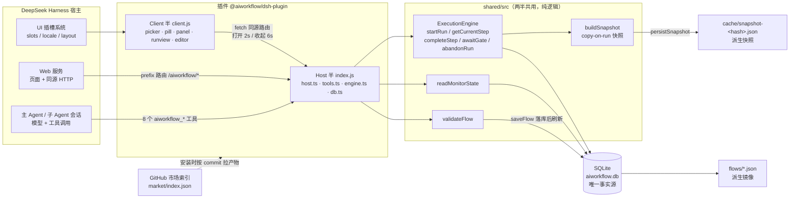
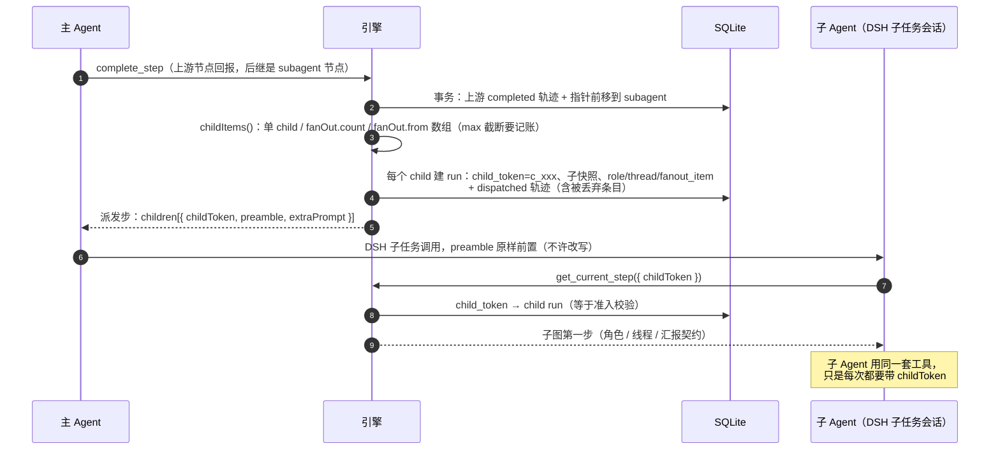
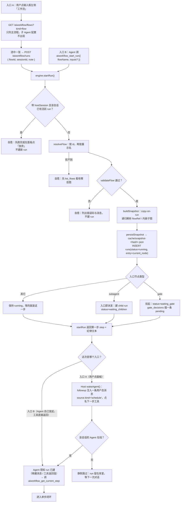
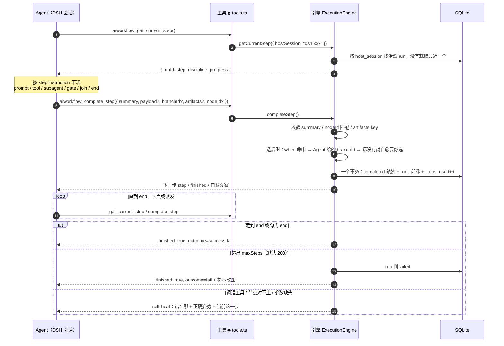
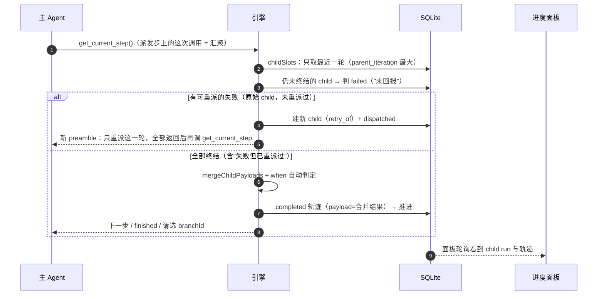
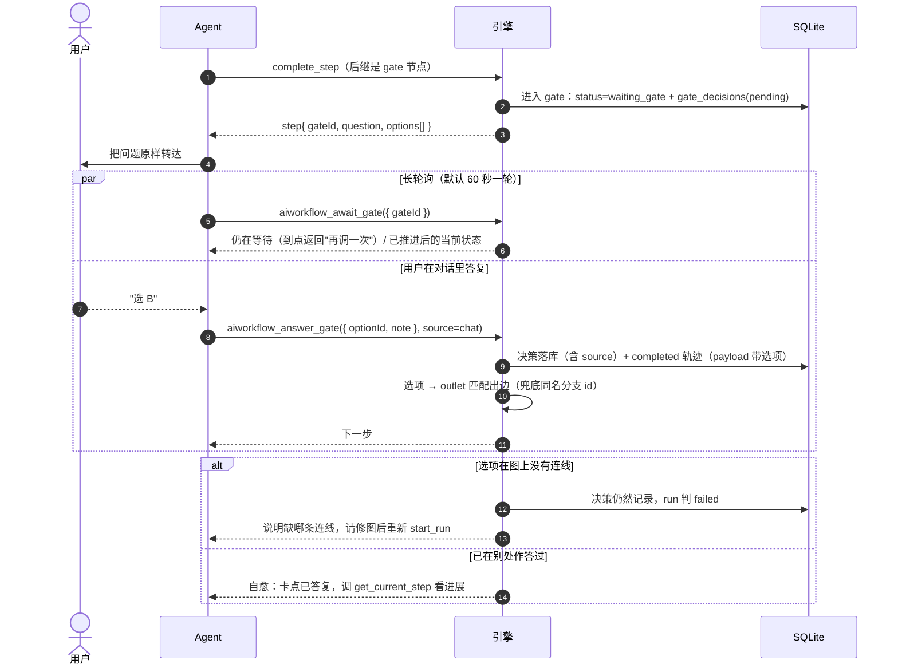
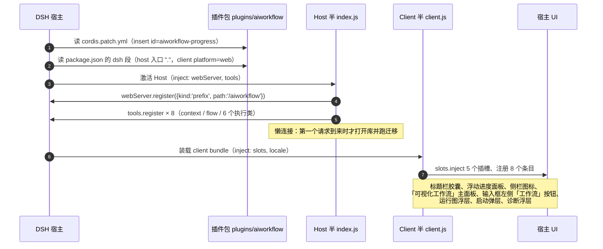

# 流程图驱动的 AI Agent 执行引擎 — 设计文档

日期：2026-09-02
最后修订：2026-10-30（迁入 `docs/plugins/aiworkflow/`，随多插件仓库改造更新路径）
状态：已评审，当前实现依据
适用范围：`plugins/aiworkflow/`（仓库内的一个插件包）
图示：关键流程用 Mermaid 内嵌在正文里（GitHub / VS Code 直接渲染）；实现改动时同步 §3、§7、§8 的图。

---

## 1. 定位

一个 **DeepSeek Harness（DSH）插件**，向 AI 编码 Agent 提供**逐步披露式**的任务流程引导。用户在插件面板上画流程图，Agent 通过 DSH 工具一次只领取当前一步的指令，做完回报结果后才领到下一步。

**核心价值不是约束 Agent，而是管理它的注意力预算。**

这个区分决定了整个设计的走向：

- **约束视角**（已否决）：假设 Agent 不听话，需要笼子。产品价值取决于笼子有多牢；而笼子永远不够牢，因为 Agent 有文件工具，能直接读流程定义。这条路是死路。
- **引导视角**（采纳）：Agent 的注意力是有限预算，一次性灌入几千字的完整流程会稀释它对当前任务的专注度。流程图是描述"何时披露什么"的最直观载体。这个价值主张不需要防住任何人就能成立。

因此：**Agent 能不能看到全图，是次要问题。默认不给它看是为了降噪，不是为了保密。**

### 1.1 只支持 DSH

本插件只面向 DeepSeek Harness：不提供独立 HTTP MCP 服务、CLI、Skill 安装器或 hook；也不适配其它 Agent 宿主。
所有 Agent 交互都通过 DSH 的 `ctx.tools` 注册的工具完成，所有界面都在 DSH 的 Web 视图里。

## 2. 设计原则

1. **逐步披露** — 每次只下发当前节点的指令、当前岔路口的条件，不下发图结构。
2. **引导而非约束** — 唯一硬性要求是"每步做完必须回报"（否则链条断裂，是机制必需）。节点执行过程中 Agent 想多读文件、多跑命令，完全放开。
3. **SQLite 是唯一事实源** — JSON 文件全部是派生的、可删的、能从 SQLite 重建。任何写入先落 SQLite 再刷 JSON，永不只写 JSON。
4. **报错必须自愈** — 所有拒绝路径都返回"错在哪 + 正确姿势 + 当前这一步是什么"，让一次往返就能修好，而不是卡死。
5. **只服务 DSH** — 宿主抽象只保留 DSH 一层：身份取 DSH 工具执行上下文，界面用 DSH 插槽，不引入 hook、MCP 会话 id 或其它宿主的兼容层。
6. **不静默截断** — 任何被丢弃的工作（fan-out 超出 max、子 Agent 失败后放弃）都必须在面板上显性列出。

## 3. 架构总览

插件分 Host / Client 两半，跑在 DSH 进程里：

| 半边 | 职责 |
|---|---|
| Host | `node:sqlite` 打开 `~/.aiworkflow/aiworkflow.db`；执行引擎、建图/执行类工具、进度与图读写 HTTP 路由（`ctx.webServer`） |
| Client | React + React Flow 界面：流程库/编辑器、进度胶囊与浮动面板、只读运行图 |

没有独立服务、端口、token 或 MCP 端点。Host 半只在 DSH 提供 `webServer` 与 `tools` 服务时激活；数据目录固定 `~/.aiworkflow/`，测试用 `AIWORKFLOW_HOME` 重定向。



图里三个边界值得记住：

- 进程内只有两个入口：**HTTP 路由**（Client 半、外部页面）和 **Agent 工具**（模型）。两者调同一批 `shared/` 函数、同一个 SQLite 连接，没有第二套逻辑。
- Client 半不碰数据库，只 `fetch('/aiworkflow/*')`；刷新页面、换浏览器都不影响状态。
- `flows/*.json` 与 `cache/` 是派生品，SQLite 写成功后才刷新，删掉不影响 run。

### 身份模型

| 角色 | 身份来源 | 丢失风险 |
|---|---|---|
| 主 Agent | DSH 工具执行上下文 `exec.agent.id`，写成 `dsh:<sessionId>` 存进 `runs.host_session` | 无（模型不接触） |
| 子 Agent | `childToken`（服务端签发，写在 preamble 里） | 低（子 Agent 上下文短、生命周期短） |

run 定位顺序：**childToken → runId → hostSession（`dsh:<sessionId>`）**。`get_current_step` 幂等，可随时取回状态；面板按 `host_session` 过滤，只显示本会话的 run。

## 4. 流程 DSL 与数据模型

### 4.1 六种节点类型

| type | 作用 | 专有字段 |
|---|---|---|
| `prompt` | 描述干什么、怎么判断 | `instruction` |
| `tool` | 指定工具与参数 | `toolName`, `params` |
| `subagent` | 派子 Agent | `extraPrompt`, `mode`, `subflow?`, `flowRef?`, `fanOut?`, `role?`, `thread?`, `produces?`, `consumes?`, `reportHint?` |
| `gate` | 人工卡点，挂起等确认 | `question`, `options[]` |
| `join` | 等并行子 Agent 全部回报后汇总 | `waitFor`, `aggregateInstruction` |
| `end` | 出口 | `outcome: success \| fail` |

`subagent.mode` 三态：

- `inline` — 只提供额外提示词，子 Agent 执行单个节点，其余上下文由主 Agent 补充
- `subflow` — 子 Agent 走一张内嵌子图；子图直接存在 `SubagentNode.subflow`，与主图一起保存/快照，不是另一张 flow
- `flowRef` — 子 Agent 走另一张已保存的工作流图

`FlowNodeBase.outlets`（卡点出口的展示元数据）、`Flow._ui.positions`、`SubflowDef._ui.positions` 与 `SubflowDef.name` 都是面板元数据：校验、引擎、快照都忽略；没有 `_ui` 时重新打开会退回自动布局。`Flow.description` 是保留字段，当前没有 UI/引擎用途（兼容手写 JSON，不要据此实现逻辑）。

子 Agent 协作字段（db v7+）：

- `role` — 引用 `flow.agents[]` 里的角色 id；角色名与 `charter` 会拼进 child preamble
- `thread` — `new`/缺省 = 一次性；`role` = 同角色跨轮共享 `role:<id>`；其它字符串 = 自定义线程 key
- `produces` / `consumes` — 产物 key 声明，只用于校验和面板提示；运行时以 `complete_step.artifacts` 为准
- `reportHint` — 给子 Agent 的汇报契约（payload 字段、产物 key），拼进 preamble

### 4.2 节点通用结构

```jsonc
{
  "id": "flow_mlbb_cl",
  "name": "配表需求改动",
  "entry": "n1",
  "maxSteps": 200,
  "nodes": [{
    "id": "n5",
    "type": "tool",
    "title": "跑测试",
    "toolName": "Bash",
    "params": { "command": "dotnet test {{n3.payload.project}}" },
    "iterationLimit": 3,
    "onLimitExceeded": "n_fail",
    "branches": [
      { "id": "b1", "condition": "全部测试通过", "to": "n6" },
      { "id": "b2", "condition": "有测试失败",   "to": "n4" },
      { "id": "b_default", "condition": "*",     "to": "n_fail" }
    ]
  }]
}
```

通用字段除上例的 `iterationLimit` / `onLimitExceeded` 外，还可配 `loopId`（回路标识，同一回路节点共用）和 `maxRounds`（只配在回路控制器节点上，控制器每执行一次算一轮）。`maxRounds` 必须同时有 `loopId`；同一 `loopId` 至多一个控制器。回路级上限优先于节点级 `iterationLimit`。

### 4.3 分支

- 条件是**自然语言**，由 Agent 自己判断。代价是非确定性，收益是无需为每个节点定 schema、无需服务端另起一次 LLM 判定。
- **下发给 Agent 时剥离 `to` 字段**，只给 `{ id, condition }`。Agent 回一个 `branchId`。理由是降噪：图的拓扑结构对 Agent 完成当前节点毫无用处，给了只是污染注意力。
- `condition: "*"` 表示 default 分支。
- **`when`（可选，P1）**：服务端可判定的单比较表达式，例如 `"{{review.payload.verdict}} == 'pass'"`。左值必须是 `{{...}}`；右值是字符串/数字/布尔/null 或另一个插值；支持 `== != > >= < <= contains in truthy empty`。所有 `when` 按声明顺序求值，第一个命中者胜出；都不命中才回落到 Agent 的 `branchId`。subagent 的自动路由步在只剩 default 时会自动走它；普通节点仍需显式选一条分支（含 default），避免 Agent 忘选时静默走默认。**有 `when` 的分支默认不交给 Agent 选**：只要节点还有自然语言/默认分支，下发时只保留这些；如果节点只有 `when` 分支，则带上 `auto: true` 一并下发，让"全部不命中"时 Agent 能看到可用分支并触发自愈。`when` 求值发生在父节点轨迹落库之前，因此 `{{review.payload.verdict}}` 用的是本轮 child 的合并 payload，而不是数据库里的旧行。解析失败硬拒 `E_BAD_WHEN`；多个 `when` 可能同时命中只给 `W_WHEN_OVERLAP` 警告。

### 4.4 节点间数据传递

`complete_step` 提交 `{ summary, payload? }`：

- `summary`（必填，字符串）— 给人看的，面板显示，也是 `join` 汇总时喂给主 Agent 的内容
- `payload`（可选，对象）— 给机器用的，供后续节点插值取字段。**不强制 schema**，与自然语言路线一致

后续节点的 `instruction` / `params` 中可写 `{{nodeId.payload.field}}`，**由服务端渲染完成后再下发**，Agent 收到的是最终文本。

P1 增补两条交接通道：

- **产物总线**：`complete_step` 可带 `artifacts: [{ key, summary?, path?, content? }]`。服务端按 `root_run_id + key` 自增 `version` 写入 `run_artifacts`；`{{artifacts.<key>.path|version|summary|content}}` 永远取最新版。正文或文件都行，preamble 只给路径/摘要，避免上下文膨胀。不带 key 的 `{{artifacts}}` 未定义，渲染时保留原 token（不会变成 `null`）。
- **run 输入**：`start_run` 的 `inputs` 落 `runs.inputs`，child 继承；`{{inputs.feature}}` 在派发时渲染。

子结果回传：child 的 `complete_step.summary/payload` 在汇聚时写入父节点执行行。单 child 时 payload 直接平铺（`{{review.payload.verdict}}`），并附带 `children[]`；多 child 时同样按声明顺序平铺（同名 key 后写覆盖），并始终保留 `children[]` 结构——需要逐 child 区分时用 `children`，不要依赖平铺后的同名 key。

### 4.5 环与迭代

环是一等公民（"测试没过 → 回到改代码"是必需场景），通过三层限制兜底：

1. **节点级** — `iterationLimit` 计数挂在 `(run_id, node_id)` 上。撞到上限时**不执行该节点**，直接走 `onLimitExceeded` 指向的逃生节点。
2. **回路级** — 同一回路的节点共用一个 `loopId`，其中**控制器节点**（同 `loopId` 中配 `maxRounds` 的节点）每执行一次算一轮。推进到该回路的任何节点时，若控制器执行数已达 `maxRounds`，不执行目标节点，落 `limit_exceeded` 轨迹并走逃生出口（目标节点 `onLimitExceeded` → 控制器 `onLimitExceeded` → 目标 default 分支）。这样"A→B→C→A"不会因为每个节点各自没超限而无限绕圈。
3. **run 级** — `maxSteps` 全局兜底（默认 200）。理由：前两层只防单点/单回路打转，防不住跨回路组合出来的病态图，也防不住引擎自身 bug。撞上判 run 失败，面板明确写"超出全局步数上限"。

### 4.6 子 Agent 配置（可复用子图）

`Flow.kind` 区分两类保存图：

- `flow`（缺省）— 可独立 `start_run` 的主流程。
- `agent` — 可复用「子 Agent 配置」：自带 `agents` 角色表和一张子图，在流程库的「子 Agent 配置」页签里用同一画布创建/编辑。它没有独立启动的语义，因此**不出现在输入框左侧的「启动工作流」列表里**（该列表用 `GET /aiworkflow/flows?kind=flow` 拉取），只能被主流程引用。

主流程通过 `subagent.mode = 'flowRef'` 引用它（和引用普通流程是同一个字段），运行时：

- child run 的 `flow_id` 就是配置 id，执行配置的 `entry`；入口是 `subagent` / `gate` 时，child 第一次 `get_current_step` 会补做入口派发/挂起；
- 子快照的角色表取**配置自己的 `agents`**（`buildSubSnapshot`），配置内部节点可以直接 `role` 引用这些角色；普通内嵌子图没有自己的角色表时仍继承父图；
- 配置被修改不影响已启动的 run（copy-on-run）；引用成环、引用自身都会被校验/快照拦下。

## 5. 存储

### 5.1 布局

```
~/.aiworkflow/
  flows/
    flow_mlbb_cl.json          # 图定义，用户级、跨项目共用
  aiworkflow.db                # SQLite，唯一事实源
  cache/
    snapshot-<hash>.json       # 按内容 hash 命名的派生快照（面板快速加载用）
```

图放用户目录的取舍：跨项目复用方便，但**无法随项目提交进 git、无法与同事共享**。v1 接受此限制，但架构上不堵路——后续可增加"额外从项目 `.aiworkflow/flows` 加载"。

### 5.2 运行时快照（copy-on-run）

**启动 run 时把图定义钉死一份快照，run 全程只对着快照执行。**

三个收益：

1. 原图可随时修改甚至删除，不影响正在跑的 run
2. 历史 run 永久可回看，面板渲染的是**当时那张图**，节点永远对得上
3. 同一张图的多个 run 互不干扰

两条实现要求：

- 快照内容存进 `flow_snapshots.content`（按内容 hash 去重），`runs.flow_snapshot_hash` 指向它；`cache/` 里那份是派生镜像。否则清缓存会把历史 run 看废。
- **`flowRef` 引用的子图必须递归一起快照**。只钉主图的话，别人改了被引用的图，问题原样复现。

### 5.3 表结构（概要）

| 表 | 关键列 |
|---|---|
| `flows` | `id`, `name`, `kind`（`flow` \| `agent`，v10）, `content`, `created_at`, `updated_at` |
| `runs` | `id`, `parent_run_id`, `root_run_id`, `flow_id`, `flow_snapshot_hash`, `entry_node`, `current_node`, `status`, `cwd`, `project_name`, `host_session`, `child_token`, `role`, `thread_id`, `inputs`, `parent_iteration`, `steps_used`, `last_activity`, `created_at`, `finished_at` |
| `flow_snapshots` | `hash`, `content`（内容寻址去重） |
| `node_executions` | `run_id`, `node_id`, `iteration`, `status`, `summary`, `payload`, `branch_id`, `started_at`, `finished_at` |
| `gate_decisions` | `id`, `run_id`, `node_id`, `question`, `option_id`, `note`, `source`（`pending` \| `panel` \| `chat` \| `abandoned`）, `decided_at` |
| `run_artifacts` | `root_run_id`, `key`, `version`, `run_id`, `node_id`, `role`, `summary`, `path`, `content`, `created_at`（v8，`UNIQUE(root_run_id, key, version)`） |

`runs.parent_iteration`（v9）是派发该 child 的父节点执行轮次。同一 `subagent` 节点在回路里会执行多轮，取 child 时必须只取最大 `parent_iteration` 的那一批，否则第二轮的汇聚会混入第一轮旧结果。

`runs.status`：`running` │ `waiting_gate` │ `waiting_children` │ `completed` │ `failed` │ `stale`

## 6. Agent 工具契约

### 6.1 工具清单

插件在 DSH 的 `ctx.tools` 上注册 8 个工具（DSH 侧统一带 `aiworkflow_` 前缀），和面板改同一份 SQLite。

**执行类**

| DSH 工具 | 签名 | 说明 |
|---|---|---|
| `aiworkflow_start_run` | `{ flowName, cwd?, projectName?, inputs? }` | 建 run（含快照），返回纪律文本 + 第一步 |
| `aiworkflow_get_current_step` | `{ childToken? }` | **幂等**。返回"我在哪、要干啥"。上下文压缩后的恢复入口 |
| `aiworkflow_complete_step` | `{ summary, payload?, branchId?, artifacts?, nodeId?, childToken? }` | 推进一格，返回下一步 |
| `aiworkflow_report_blocked` | `{ reason, nodeId?, childToken? }` | 干不下去，见 7.8 的处理规则 |
| `aiworkflow_await_gate` | `{ gateId?, childToken? }` | 长轮询上限 60 秒，超时返回"仍在等待，请再调一次" |
| `aiworkflow_answer_gate` | `{ gateId?, optionId, note?, childToken? }` | 代填用户在聊天中的答复，记 `source: 'chat'` |

**建图类**：合并为 `aiworkflow_flow` 的 `action` 参数——`list` / `get` / `validate` / `create` / `update`。模型侧少背 4 个 schema，行为不变。
另有只读的 `aiworkflow_context`（当前 DSH 会话、工作目录、库路径、流程与 run 计数）。

**工具注册即入场，不需要 Skill 文件或安装器。** DSH 启动插件时 Host 半注册工具；Agent 在会话里直接看到它们。

**建图类不做任何模式隔离，run 期间也可自由调用。** 运行时快照已保证 `update` 不会打乱正在跑的 run；而阻止 `get` 读图既拦不住有意为之的人（Agent 有文件工具），也与"引导而非约束"的定位矛盾。

### 6.2 单步返回结构

```jsonc
{
  "runId": "run_a1b2",
  "step": {
    "nodeId": "n5",
    "kind": "tool",
    "title": "跑测试",
    "instruction": "对 apps/battle 跑单测……",
    "tool": { "name": "Bash", "params": { "command": "dotnet test ..." } },
    "branches": [
      { "id": "b1", "condition": "全部测试通过" },
      { "id": "b2", "condition": "有测试失败" }
    ]
  },
  "discipline": "做完必须调 complete_step 并给出 branchId。",
  "progress": { "completed": 4 }
}
```

两处刻意的省略：`branches` 不含 `to`，`progress` 不含总数。都是降噪，不是保密。

每个响应都复述 `runId` + `nodeId`，使上下文中最近一条 tool result 永远携带完整身份。

不同 `kind` 的 `step` 各自附带专有字段：

| `kind` | 专有字段 |
|---|---|
| `prompt` | 无（仅 `instruction`） |
| `tool` | `tool: { name, params }` |
| `subagent` | `children: [{ childToken, preamble, extraPrompt }]`（非 fan-out 时长度为 1） |
| `gate` | `gateId`, `question`, `options: [{ id, label }]` —— `gateId` 由此处取得，用于后续 `await_gate` / `answer_gate` |
| `join` | `childResults: [{ childToken, status, summary, payload? }]`, `aggregateInstruction` |
| `end` | `outcome` |

所有步骤在角色/线程配置下还会带 `role?`、`thread?`、`turn?`（child 自己的步骤取 `runs.role/thread_id`）。

### 6.3 自愈式报错

所有拒绝路径均返回三段式：**错在哪 + 正确姿势 + 当前这一步是什么**。适用于 `branchId` 非法、`childToken` 过期、节点不匹配、跳步等情况。目标是一次往返修复，而非返回裸 error 导致卡死。

### 6.4 纪律文本由引擎下发

完整的循环纪律**不写进静态说明文件**，而由 `start_run` 返回值下发。理由：静态文件不会跟随插件升级，版本一漂就失配（引擎改了工具签名，说明仍在教旧用法）。插件工具的描述只保留"什么时候用它"的短句，循环纪律始终以服务端返回为准。

下发文本要点（引导语气）：

> 你正在按一张流程图分步推进任务。图不会一次给你全部内容——每次只给当前这一步，做完回报后才给下一步。
> **硬的一条**：每步做完必须调 `complete_step`，否则链条断在你这里。
> **完全放开的**：执行某一步时你想多读文件、多跑命令、多查一点，随意——只要最后把结果回报。
> 不确定自己在哪：调 `get_current_step()`。

代价：纪律语气不在用户可读的文件里，想调整须改服务端。已接受。

## 7. 执行引擎

### 7.1 run 树

一次执行是一棵树。`parent_run_id` / `root_run_id` 描述层级：主 Agent 为根，每个子 Agent 一个 child run（`inline` 模式只含一个节点，`subflow` / `flowRef` 模式走自己的子图）。

child 是在**推进事务之后**由服务端先行建好的——这样面板立刻可见、`childToken` 校验退化成白名单查表、`max` 截断能记账（§7.4）。



- `child_token` 既是查询键也是准入凭据：拿不到对应 run 的 token 一律自愈拒绝。
- 子 Agent 不走特殊接口，跑的是同一套 `get_current_step` / `complete_step`，差别只在每次都要带 token。

### 7.2 启动与推进语义

run 的生命周期只有两个动作：**启动**（建 run + 落快照 + 定入口）和**推进**（`complete_step` 走一格）。

**启动**：面板「工作流」按钮和 Agent 的 `start_run` 两个入口最后都汇到 `engine.startRun`，之后的差别只在"谁来唤醒 Agent"。



- 两个入口的差别只在最后一步：A 由 Host 主动唤醒（`followup`），B 的 `startRun` 结果就是工具返回值。
- 「一会话一活跃 run」守卫只认 `hostSession`：同会话两个活跃 run 会让执行类工具永远命中最新那个，旧 run 静默失联（§7.7）。
- 入口即 gate / 入口即 subagent 是特判——`startRun` 不会停在入口节点上，直接挂起或派发；唤醒失败不影响正确性，状态全在库里。

**推进**：Agent 侧看到的就是「领一步 → 干活 → 回报一格」，引擎不保存 Agent 的游标，位置只在 `runs.current_node`。



- 执行类工具**无状态**：Agent 不持有游标，上下文被压缩后一句 `get_current_step` 就能找回位置（§6.1）。
- 分支不由模型猜：有 `branches` 而 `when` 没命中时必须显式给 `branchId`，否则自愈要你选（边界见 7.3）。
- `maxSteps` 在**每条**推进路径上都检查（complete / report_blocked / 汇聚 / 卡点放行），防止自动回环绕过。

`complete_step` 在单个事务内完成：校验 run 与节点匹配 → 落 `node_executions` → 按 `branchId` 查快照定位后继 → 检查后继迭代上限 → 渲染 `instruction` 插值 → 返回。中途任何失败都不推进，走自愈返回。

### 7.3 分支求值的边界情况

| 情况 | 处理 |
|---|---|
| 节点无分支 | 走唯一后继；无后继 = 隐式 end |
| 有 `when` 且命中 | 服务端直接走第一个命中的分支，Agent 不需要回 `branchId` |
| 有 `when` 都不命中、还有自然语言分支 | 返回路由步（带 childResults/payload），由 Agent 选 `branchId` |
| 有 `when` 都不命中、只剩 default（subagent 自动路由步） | 自动走 default |
| 有 `when` 都不命中、只剩 default（普通节点） | 不自动走；Agent 必须显式回 `branchId`（含 default），避免忘选时静默走默认 |
| `branchId` 非法或缺失 | 普通节点不推进，自愈返回（附合法 id 列表）；`when` 分支不允许手工选不匹配的 |
| 多个自然语言条件都满足 | Agent 只回一个 id，服务端不裁决 |
| 都不满足 | Agent 选 `condition: "*"` 的 default 分支 |
| 无 default 且都不满足 | run 判失败，面板标红 |

### 7.4 并行 fan-out

节点配置 `fanOut: { from: "{{n3.payload.modules}}", max: 5 }`（也支持固定 N）。

**派发时服务端先把 N 个 child run 建好，再把 `children[]` 返回给主 Agent。** 三个理由：

1. 面板立刻能显示"已排 5 个子任务 / 完成 0"，不必等子 Agent 自行注册
2. `childToken` 校验退化为白名单查表
3. `max` 截断时能明确记录**被丢掉了哪几个**，并在面板显性标出

### 7.5 join 汇聚

主 Agent 的 Task 调用全部返回后调一次 `get_current_step`（宿主的子 Agent 调用本身会阻塞到子 Agent 结束，因此主 Agent 无需轮询）。服务端按 child run 状态分三路：

| child 状态 | 处理 |
|---|---|
| 全部 `completed` | 返回 join 步，`instruction` 含 `aggregateInstruction` + 所有子结果 `summary` |
| 有 child 仍 `running` | 说明该子 Agent 挂了或未回报。服务端将其置为 `failed`，并落一条 `blocked` 轨迹（`summary` 记"未回报：Task 调用已返回但子任务没有 complete_step"），转入下一行的失败处理 |
| 有 child `failed` | 对每个失败的 child **新建一个 child run 并签发新 `childToken`**（旧 run 保留为失败记录，便于回看），返回一个新的 `subagent` 步让主 Agent 重派。**重试只做一轮**；仍失败则带着已有结果推进到 join，面板标黄并记明缺了谁 |

重派使用新 child run 而非复用旧 run，是为了让面板能同时看到"第一次失败了"和"重试的结果"，而不是被覆盖掉。



汇聚这一步有两个反直觉点：**它由 `get_current_step` 触发**（不是 `complete_step`），以及**重复调用必须幂等**——所以服务端每次都只对"稳定的终态"收敛，绝不重复建 child。

实现落点（阶段 6 实测后补记）：

- 派发步把主 run 置 `waiting_children`；汇聚由主 Agent 在派发步上调 `get_current_step` 触发（对稳定的 child 终态收敛，重复调用幂等）。
- child 的 `extraPrompt` 用**主 run 的产物**渲染插值后写进 child 快照（inline 模式即子任务指令）；subflow 内的插值则在 child 自己的上下文里正常走。
- child 快照从父快照切出（`buildSubSnapshot`），不回读当前库——child 与主 run 钉同一版本。
- child 建库在主 run 推进事务**之后**（插值需要刚提交的本步产物）；若两步之间进程崩溃，汇聚时发现无 child 会按节点配置惰性补建，不把 run 卡死。
- 重派一轮用 `runs.retry_of`（db v4）指向被替代的旧 run；"最新一批" = 有 retry 取 retry、否则原始。

多 Agent 回路（P1）补记：

- 同一个 `subagent` 节点会被回路反复执行，child 用 `runs.parent_iteration` 标记"第几轮派发"。`childSlots` / `currentWave` 只取最大轮次，重派沿用原轮次，避免把历史轮次卷进本轮汇聚。
- `subagent` 节点全部 child 到终态后：`when` 能判定的直接推进；仍有自然语言分支时返回**路由步**（`step.childResults[]` + `branches[]`），Agent 调 `complete_step({ branchId })`；写父节点轨迹时把本轮合并 payload 带上。
- 子结果进入父 payload：单 child 直接平铺；多 child 按声明顺序平铺（同名 key 后写覆盖），并始终附带 `children[]`；需要逐 child 区分时用 `children`。

### 7.6 人工卡点

`gate` 节点将 run 置为 `waiting_gate` 并写一条 pending `gate_decisions`。当前插件提供对话通道：

- 用户在对话里答复；Agent 调 `answer_gate` 代填（`source: 'chat'`）。
- 引擎仍保留 `source: 'panel'` 的写入能力，供以后面板点选接入；当前插件面板只读展示待决卡点，不提供点选。



卡点不占线程：`await_gate` 是 60 秒一轮的 DB 轮询，到点返回"仍在等待，请再调一次"；放行则是一次普通推进（与 `complete_step` 同一条事务路径）。

放行时必须记录 `source`，否则事后回看轨迹无法分辨该卡点是在什么场景下放过的。

实现落点（阶段 5 实测后补记）：

- 下发给 Agent 的 gate 步只带 `gateId / question / options`，**不带 `branches`**——选项即出口，出口由人工选择，分支条件对 Agent 是噪音。
- `gateId` 即 pending `gate_decisions` 行 id（数字串）；pending 期 `source` 置占位值 `pending`，放行时更新为 `chat`（引擎也接受 `panel`，供后续 UI 接入）。run 被「放弃」时，未决卡点会被关闭（`source = 'abandoned'`、`decided_at` 落时间），旧 `gateId` 不能再把 run 复活。
- 放行时除更新决策行外，还落一条 `node_executions`（`completed`，payload 含 optionId / optionLabel / note / source）：后续节点可用 `{{gateId节点.payload.optionId}}` 插值，面板轨迹也天然能看到"谁在什么场景放的行"。
- 选项按分支的 `outlet`（其次分支 id 同名）对应出口；**选项未连线时决策保留、run 判失败**（校验器存图时以警告档 `W_GATE_OPTION_UNWIRED` 提醒）；无任何分支与 `next` 的裸卡点记录决策即隐式收尾。
- `await_gate` 是 400ms 粒度的 DB 轮询（上限 60 秒），不依赖进程内事件——与"事件只是刷新信号"的定位一致。

### 7.7 崩溃与孤儿 run

**系统不基于时间做任何状态改写**（2026-09-08 决定移除停滞检测）：服务端重启后，库中
`status=running` 的 run 保持原状，不自动标记。同一会话/childToken 下可以继续调
`get_current_step` 续跑；如果不打算继续，用户在进度面板点「放弃」会调用
`abandon_run`，把该 run 及其未终结的 child 一起置为 `failed`，并落一条 `blocked` 轨迹记明原因
（面板走 `POST /aiworkflow/runs/abandon`）。`stale` 只作为历史库的兼容展示值，引擎不会新写入。

同一会话同时只允许一个活跃 run：`start_run` 发现 `hostSession` 已有 `running/waiting_*` 的 run
时会返回自愈错误，提示先完成或在面板放弃——否则执行类工具只能按会话命中最新 run，旧 run 会静默失联。

### 7.8 `report_blocked` 的处理规则

落一条 `node_executions`（`status = blocked`，`summary = reason`），然后按优先级顺序取第一个可用出口：

1. 该节点配了 `onLimitExceeded` → 走它（逃生出口复用）
2. 该节点有 `condition: "*"` 的 default 分支 → 走 default
3. 都没有 → run 判 `failed`，面板标红并显示 `reason`

**不做自动重试。** 重试语义已由 `iterationLimit` + 回指边表达；在这里再加一层会与之打架，且 Agent 报 blocked 通常意味着重试也没用。

child run 调 `report_blocked` 时，该 child 置为 `failed`，随后由 7.5 的失败处理接管。

## 8. DSH 插件接入

插件不引入任何 hook、Skill 安装器或状态注入层，Agent 侧只做两件事：

1. **注册工具**：Host 半在 `ctx.tools` 上注册 §6.1 的 8 个工具；工具描述只说"什么时候用"，循环纪律由 `start_run` 返回值下发。
2. **注册同源路由**：Host 半在 `ctx.webServer` 上挂 `/aiworkflow` 前缀路由，供 Client 半读取进度、读写流程图；不另起端口、不要 token。

**激活条件**：插件声明 `inject: ['webServer', 'tools']`，缺少任一服务的 DSH 组合里 Host 半不激活，Client 界面也不会出现。

装载顺序：



- 注册全包在 `ctx.effect` 里，卸载时反注册并关闭数据库句柄。
- 「运行图」页签是**动态注册**的：只有本会话有 run 时才注入，切到没跑过的会话自动撤掉。
- 数据库惰性打开；打不开时路由返回 `available:false` + 原因，面板显示诊断而不是白屏。

**上下文压缩的缓解**：压缩后没有外部提醒，Agent 可能悄然脱离流程。三层缓解——每个工具返回值复述状态、`get_current_step` 幂等可随时取回、纪律文本明确写"不记得就调它"。按"引导"定位，脱离流程本身不算灾难，只是失去逐步披露的收益。

### 8.1 会话身份

主 Agent 的身份**只从 DSH 工具执行上下文取**：`exec.agent.id` 写成 `dsh:<sessionId>`，存进 `runs.host_session`。
`get_current_step` / `complete_step` 等执行类工具不需要 Agent 传 `runId`；子 Agent 用服务端签发的 `childToken` 定位。
不引入 `_host`/`_sid` 入参、MCP 会话 id 或 hook；模型不需要书写身份，也没有第二套身份来源。

### 8.2 子 Agent preamble

`subagent` 节点下发时给出一段**必须原样前置、不许改写或摘要**的文本：

```
[以下内容由流程引擎提供，请原样前置，不要改写或摘要]
你是流程 run_a1b2 节点 7 派出的子任务，你的 childToken 是 c_7x2f。
你的角色：设计 Agent（role=designer）。
角色章程：负责设计方案，按评审意见修订
你的线程：role:designer，这是第 2 轮。
同线程最近几轮摘要：
- 第 1 轮（designer，completed）：设计 v1
汇报契约：payload 带 verdict（pass/fail）与 issues；产物 key=design
调 get_current_step({childToken:"c_7x2f"}) 取你这一步要做什么。
做完调 complete_step({childToken:"c_7x2f", summary, payload?, branchId?, artifacts?})。
[主 Agent 的补充说明写在这行之后]
```

角色/线程/摘要段只在节点声明了 `role` 或 `thread` 时出现；线程摘要最多 5 条、封顶 1200 字符。由主 Agent 补充上下文，preamble 原样携带。子 Agent 首次调用时服务端校验 token 在白名单内，不在则自愈返回。

## 9. 编辑器与监控面板

### 9.1 编辑器

- 节点用调色板点选或画布右键菜单在指针处新建，从节点右侧圆点拖线连边（连线即分支）；分支 `condition` 在选中**源节点**后的属性面板里按出边编辑，`when` 在每路条件下方的高级输入框里填。六种节点以颜色 / 图标区分，右侧按 `type` 显示对应字段表单
- `subagent` 的 `subflow` 支持卡片内只读缩略图 + 「打开」下钻编辑；返回主图时整张子图随主图一起保存/校验；调色板的「评审回路 / 测试回路」模板会插入带 `loopId + maxRounds` 的内嵌子图
- **属性面板按使用频率分三层**：头部（类型、标题就地编辑、id 复制、入口标记 + 概览 chip）→ 核心字段（每类 1–3 个必填/最常改项）→ 折叠的高级设置（角色与线程、产物与汇报、并行派发、循环与逃生、本步指令）。概览 chip 由 `summarizeNode()` 生成（角色/线程、产物、子图、并行、回路、出口数），点击展开对应分组；高级字段的说明收进 label 右侧的 i 提示，不占常驻行高
- 面板顶部页签「节点 / 图」；`subagent` 的 `role` 下拉引用全图角色表，角色表（id/name/charter/produces/consumes）在「图」页签维护，不再占节点面板
- 流程库分「流程 / 子 Agent 配置」两个页签：后者是 `kind = 'agent'` 的保存图，自带 `agents` 角色表，用同一画布创建和编辑；主流程通过 `subagent` 节点的「引用」模式按 id 调用（见 §4.6），`flowRef` 下拉按类型分组
- **技术选型：React Flow**。自定义节点、连线交互、缩放定位均现成
- **插值提示的固有限制**：输入 `{{` 时能提示的只有前序**节点 id**，`payload` 字段名运行时才知道。补法是从历史 run 中学习该节点曾出现过的字段名作候选。首次画图无提示，用过几次后有

**保存时校验分两档**，严格度对应"必然出错"与"可能出错"：

| 硬拒（不许保存） | 警告（允许保存） |
|---|---|
| 环无逃生出口 | 缺 default 分支（`gate` 除外：出口由人工选择） |
| 孤立节点（从 `entry` 不可达） / 无 `entry` | `join` 找不到对应 `fanOut` |
| 存在无法终止的路径 | 环上节点缺 `iterationLimit` / 回路缺 `maxRounds` |
| `maxRounds` 缺 `loopId`，或同一 `loopId` 多个控制器 | `loopId` 没配 `maxRounds` 控制器 |
| 卡点 `outlet` 指向不存在的选项 / 同一 `outlet` 多条分支 | — |

第三条"无法终止的路径"指从 `entry` 出发存在一条走不到任何终点的路径。**注意终点有两种**：显式 `end` 节点，或按 4.3 的隐式 end（节点无分支且无后继）。两者都算合法终止，校验不得只认显式 `end`。

### 9.2 监控

**run 切换器**：按会话（`host_session`）过滤，单行列出流程名与相对时间；进行中的排前面、最近结束的排后面。不做 `cwd` 分组/四栏分栏（`cwd`/`projectName` 只落库供诊断，UI 目前不读取）。进行中的 run 在浮动面板里可点「放弃」结束。

**run 详情**用快照那张图渲染：

- 节点着色：已过 / 正在跑 / 失败 / 未走到 / 未选中的分支（虚线）；「正在跑」目前只换边框色，没有脉动动画
- 走过的路径高亮，**环要能看出绕了几圈**——同一节点多次执行时，侧栏按迭代次序列出每一次结果；面板的路径条把同一节点的连续执行合并成 `×n`（`dispatched` 记账行不算独立一圈）
- 点节点 → 侧栏显示该次的 `summary`、`payload`、迭代序号与时刻（未计算耗时）
- 子 run 用「根 run + 直接子运行卡片」两层展示：顶部只列根 run，父 run 右侧「子运行」卡片按 `parentNode` 过滤并可点进 child 快照（child 详情有「← 父 run」）；fan-out 的子任务按行列出，不做 N 个并排，也不做无限深的树形缩进；**被 `max` 截断丢掉的条目在派发轨迹与步骤 note 里显性列出**
- 子 run 详情显示 `role`、`threadId`、派发轮次 `parentIteration`；右侧「产物」卡按 key/version 列出 `run_artifacts`，路径与摘要直接可见
- 引用「子 Agent 配置」的 child run 同样按普通 run 展示：`RunListItem.flowKind = 'agent'`，子运行卡片显示配置名 + 「配置」徽标，父节点显示引用节点的标题；点画布上的引用节点即可筛出它的子运行
- 人工卡点在此只读展示问题与选项；用户在对话里回复选项，Agent 代填后这里自动继续
- **停滞检测（已移除，2026-09-08 用户决定）**：原设计为 15 分钟标黄、24 小时自动标 `stale`。移除原因：AI 在执行中长时间暂停是常态（长任务、等待用户），按超时判异常会产生误导。系统不基于时间做任何状态改写；`stale` 状态仅作为历史遗留兼容展示。

### 9.3 刷新方式

**Client 半轮询 Host 路由**（打开时 2 秒、收起时 6 秒，页面隐藏暂停），不使用 WebSocket 或 SSE。
读走 `GET /aiworkflow/state`，写（建 run、图读写、放弃 run）走普通 POST/PUT/DELETE；卡点答复走 Agent 工具而不是 HTTP 路由。没有长连接，也不需要重连逻辑。
`EngineEvent` 仍保留在引擎层，供进程内消费者使用；插件不把它接到网络通道。

Host 路由一览（全部同源，无 token）：

| 方法 | 路径 | 参数 | 用途 |
|---|---|---|---|
| GET | `/aiworkflow`、`/aiworkflow/state` | `?run=&session=` | 面板状态：活跃/最近 run + 选中 run 详情 |
| POST | `/aiworkflow/runs` | `{ flowId \| flowName, sessionId?, note? }` | 建 run 并用 followup 唤醒 Agent |
| POST | `/aiworkflow/runs/abandon` | `{ runId }` | 放弃 run（root + 未终结 child 置 failed） |
| GET | `/aiworkflow/flows` | `?kind=flow\|agent` | 流程/配置列表 |
| POST | `/aiworkflow/flows/validate` | 完整 Flow | 干跑校验，不落库 |
| GET/PUT/DELETE | `/aiworkflow/flows/:id` | — | 读取 / 保存（校验不过不落库）/ 删除 |
| GET | `/aiworkflow/flows/:id/payload-fields` | — | 历史 payload 字段提示 |

## 10. 验证方式

- **引擎 / 校验 / 存储 / 迁移**：`vitest`，数据库用内存 `node:sqlite`，覆盖六种节点、分支/环/迭代上限、gate、子 Agent、fan-out、快照、P1 多 Agent 语义、子 Agent 配置以及 v5→v10 迁移。
- **类型与打包**：`npm run typecheck`（shared + 插件）与 `npm run build:plugin`；Host 产物必须只外置 `node:` 内建。
- **DSH 实机**：在 `dsh web` 或桌面版里装载插件，跑一张含 gate 与 subagent 的图，验证工具注册、会话隔离、面板与运行图。

## 11. v1 范围外

明确不做，但架构上不堵路：

- **服务端直连执行 `tool` 节点** — 若目标工具可由 Host 半直接调用，可让该节点成为真确定性。v1 不做，`tool` 节点仍由 Agent 执行并回报
- **从项目目录加载图** — 使流程可随项目提交进 git、与同事共享
- **图的版本管理与 diff**
- **拦截类或状态注入类机制**（审批、往上下文塞提醒）——与"引导而非约束"矛盾
- **子 Agent 同级直连消息** — 当前全局 `send_message` 只允许父↔直接 child；P1 的协作走"父级中转 + 轮次/产物"，不引入 experimental Agent Teams，也不做插件 broker。直连保留为 P3 可选

## 12. 已知局限

1. **流程是建议性的。** DSH 工具是拉取式接口，引擎没有中断能力。Agent 跳步或脱离流程只能事后发现并自愈返回，无法阻止。这是机制层面的性质，不是待修的缺陷——设计已按此前提展开。
2. **"Agent 看不到图"是默认行为，不是安全边界。** Agent 有文件工具，可直接读 `~/.aiworkflow/flows/*.json`。该机制挡住的是"顺手读图"这一真实且高频的失效模式，而非有意为之的行为。
3. **分支判断非确定性。** 条件是自然语言、由 Agent 判断。同样输入可能选不同分支。
4. **图无法随项目共享。** 见 5.1。
5. **多 Agent 协作是父级中转，不是同级直连。** Review 的结论先回主 Agent，再由主 Agent 派给设计/开发；多一跳延迟，但不需要 experimental Agent Teams，也不依赖子 Agent 在线。线程摘要只给最近 5 轮、1200 字符，跨很多轮的细节需要写进产物文件。
